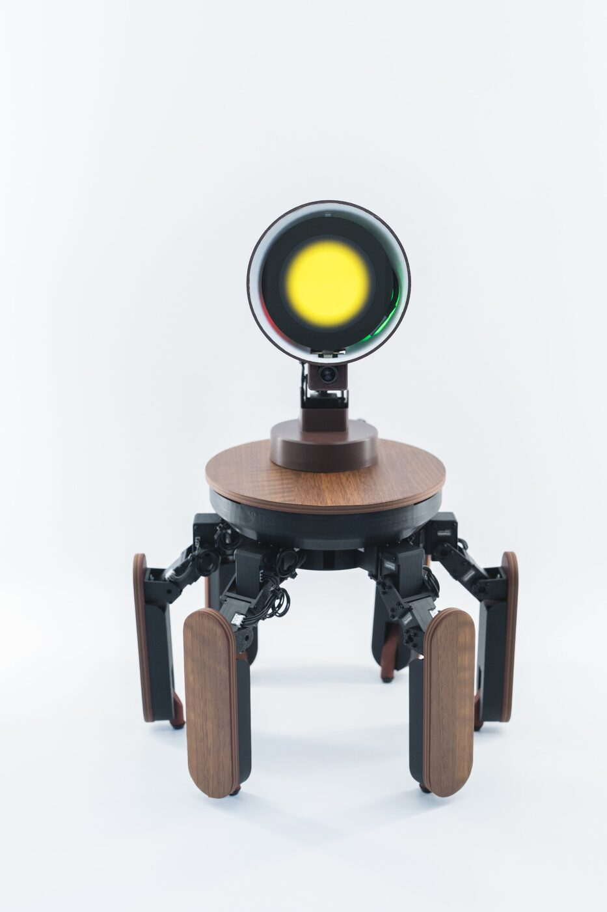
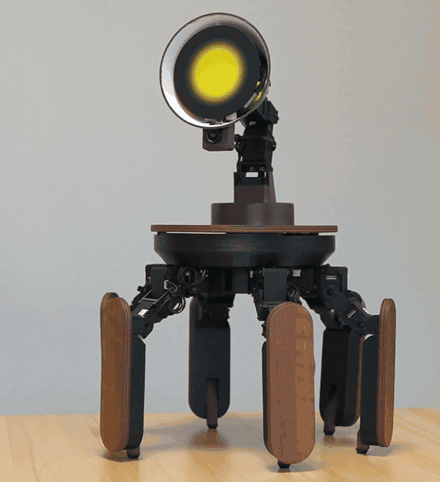
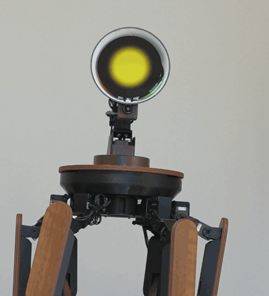
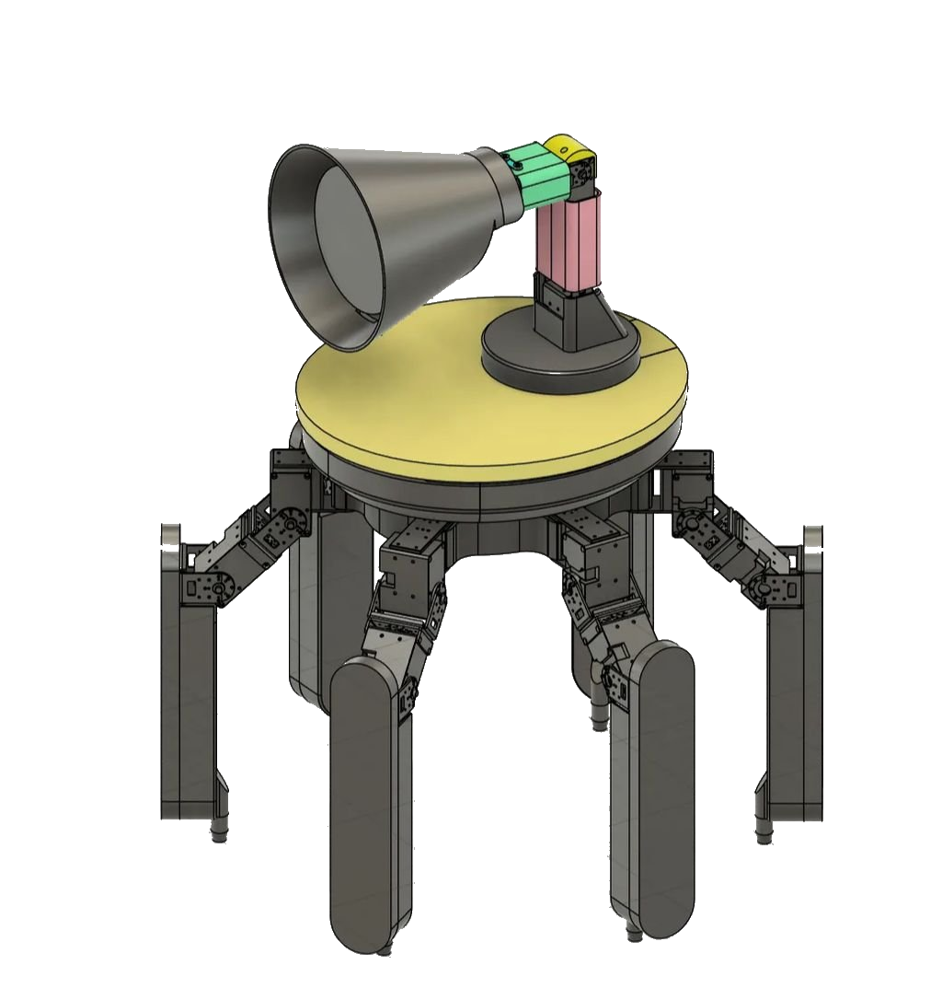
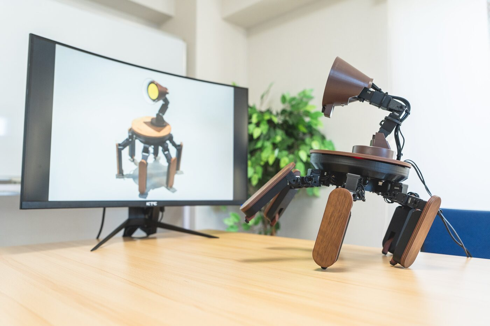

<div align="center">

# Palmimo DevKit

**AI エージェントに身体を。** Palmimo DevKit は、自分で書いた Python で動かせる
6 脚の卓上 AI ロボットです。オープンソースの SDK、MCP サーバー、エージェントのサンプルを
[Jizai Inc.](https://jizai.ai/) が提供しています。

[Web サイト](https://palmimo.dev) · [ドキュメント](https://docs.palmimo.dev/ja/) · [DevKit を入手](https://palmimo.dev#specs)

[English](README.md) | **日本語**




</div>

Palmimo は、カスタマイズできる汎用 AI ロボットです。目を合わせ、声に応え、
表情や身振りで語りかける卓上のコンパニオンです。
**Palmimo DevKit** はその開発キットです。ロボットは組み立て・テスト済みで届きます。
このリポジトリには、それを動かすソフトウェアを収めています。Python SDK、LLM のツール呼び出しを
ロボットの動作に変える MCP サーバーとエージェントのサンプル、そしてドキュメントです。

内部では、脚の 18 個のサーボがトライポッド歩容で歩行を担い、サーボで動く首が丸い
フェイスディスプレイの向きを変え、小さな表情エンジンが表情を作ります。すべて数行の
Python から操作でき、ロボティクスの予備知識は必要ありません。

基本となる考え方は、単一の**モーションエンジン**（純粋な歩容計算と逆運動学（IK）、I/O なし）で、
差し替え可能なフロントエンドからロボットを動かすことです。フロントエンドには `palmimo_sdk` Python
API とエージェントアプリのサンプルがあります。どのモーションも、サーボに届く前に、
ハードウェアを接続しないドライランで計算できます。

```
Palmimo.forward() → step() → MotionEngine computes → {servo_name: tick} → ServoDriver → hardware
                                                                     (or compute-only in dry-run)
```

## ✨ 特長

- **AI エージェントに対応** — `palmimo_sdk.agent` は LLM のツール呼び出しをロボットの動作に変えます
  （歩く、手を振る、視線を向ける、表情を変える、話す、フレームを撮影する）。背後のモデルは
  差し替え可能です。`palmimo_sdk.mcp` は同じツールを MCP 経由で Claude Code、
  OpenClaw、その他の MCP クライアントに提供します。サンプルアプリにはウェイクワードエージェントと
  常時動作するコンパニオンエージェントがあります。[サンプル](examples/README.md)と
  [MCP での提供](doc/ja/guides/mcp-server.md)を参照してください。
- **数行の Python で操作** — `robot.wave()`、`robot.look(...)`、`robot.forward()`。
- **18 種類の組み込みモーション** — 歩行と旋回（`forward`、`strafe_left/right`、
  `rotate_left/right`、`creep`）、ジェスチャー（`wave`、`bow`、`clap`、...）、
  ポーズ（`stretch`、`dance`、`pushup`、...）を、逆位相の
  **トライポッド歩容**で動かします。全一覧は
  [モーション一覧](doc/ja/reference/motions.md#利用可能なモーション)を参照してください。
- **ピッチ・ヨー方向に動く首** — `look(pitch, yaw)` で、歩行とは独立に、
  同時に向きを変えられます。首には 3 つ目の関節もあり、モーションエンジンはそれを
  ニュートラルに保ちます。[モーションの制御](doc/ja/guides/controlling-motions.md#実際のハードウェアにも送る)を参照してください。
- **振り付け** — `Palmimo.play_realtime()` で `(motion, seconds)` のステップを順に実行します。
- **豊かな表情** — パラメトリックな（画像素材を使わず数式で描く）表情の
  バリエーション（HAPPY、ANGRY、SAD、EXCITED、THINKING、SLEEPY、…）を、USB-CDC 経由で
  フェイスディスプレイ基板に描画します。感情はホストが決め、基板は描画だけを担当します。
- **音声（オプション）** — `piper-plus` TTS と、GTCRN によるノイズ除去を備えた
  共有マイクストリームによる収音（`palmimo_sdk.audio`）を、エージェントアプリのサンプルが使います。
- **中核となる Python API** — `palmimo_sdk.Palmimo` が 1 つの `MotionEngine` を動かします。エージェントアプリの
  サンプル（[サンプル](examples/README.md)を参照）は、その上にフロントエンドとして構築されています。
- **まずドライラン** — どのモーションもハードウェアなしで計算できるので、ロボットを
  接続せずにモーション API を試せます。サーボバス、フェイスディスプレイ、スピーカーを必要とする
  呼び出しの多くは、対象がなければ何もしません。例外を送出するものは
  [API リファレンス](doc/ja/reference/api-reference.md)に記載しています。

<div align="center">

 

<sub>実機での <code>robot.bow()</code> と <code>robot.wave()</code>。</sub>

</div>

## 🦾 ハードウェア

Palmimo DevKit は、21 個のシリアルバスサーボ
（脚 18 個と首 3 個）、丸いフェイスディスプレイ、5 MP カメラ、マイクアレイ、ステレオ
スピーカー、制御ホストの Raspberry Pi 5 を搭載しています。ソフトウェアが
何と、何を介して通信するかは、
[システムアーキテクチャ](doc/ja/explanation/architecture.md#実行モデル)に記載しています。
ハードウェアの設計ファイルはこのリポジトリに含まれません（
[CONTRIBUTING → 対象範囲](CONTRIBUTING.md#scope-what-lives-here)を参照）。詳細な
仕様は [palmimo.dev](https://palmimo.dev#specs) にあります。

<div align="center">



</div>

## 🔓 公開しているものと、同梱されるもの

- **現在公開中（Apache-2.0）:** `palmimo_sdk` Python SDK とドライバー、エージェント
  レイヤーと MCP サーバー、エージェントのサンプルと OpenClaw 接続キット、
  LeRobot プラグイン、診断ツール、そしてこのドキュメントです。
- **段階的に公開予定:** SDK 以外の開発スタックも、シミュレーション用の
  ロボットモデルとロボット学習用の環境から順に公開します。今後の公開は
  [Discussions → Announcements](https://github.com/Jizai-inc/palmimo-devkit/discussions/categories/announcements)
  をご覧ください。
- **非公開:** ハードウェアの製造設計です。ハードウェアに関する要望の
  送付先は [CONTRIBUTING → 対象範囲](CONTRIBUTING.md#scope-what-lives-here)を
  参照してください。

## 🍓 制御ホスト: Raspberry Pi

Palmimo の制御ホストは **Raspberry Pi 5** です。サーボバスに
USB で接続され、イメージを書き込み済みの状態で届きます。
[Raspberry Pi のセットアップ](doc/ja/guides/raspberry-pi-setup.md)ガイドでは、カードに一から書き込み、
Wi-Fi、SSH、クイックスタートが前提とするランタイムを準備します。同梱カードへの
再書き込みにも、自分で用意した Pi の準備にも使えます。

まだロボットがなくても、どのモーションもハードウェアなしで計算できます。
[Python API を試す](#python-api-を試すハードウェア不要)へ進んでください。

## 🚀 クイックスタート

Raspberry Pi に SSH で接続して実行します。前提条件は **Python 3.12+** と
[**uv**](https://docs.astral.sh/uv/) です。上のセットアップガイドで
カードに書き込む際にインストールします。

1. **コードを取得する** — Pi 上で `git clone https://github.com/Jizai-inc/palmimo-devkit.git`
   を実行します。
2. **インストールする** — リポジトリのルートから `uv sync` を実行します。
   [インストールガイド](doc/ja/guides/installation.md)で extras、音声モデル、
   インポートに失敗した場合の対処を説明しています。
3. **サーボを確認する** — `uv run python scripts/diagnose_servos.py scan` で、
   初回実行の前にすべてのサーボが応答することを確かめます。その他のサブコマンドは
   [ユーザー向け診断ツール](scripts/README.md)を参照してください。

コマンドはサーボバスを自動検出します。検出が曖昧になる場合の明示的なポート指定は、
該当する箇所で説明しています。

> ⚠️ **ロボットを床や机に置く前に、脚を浮かせてモーションをテストしてください** — まず
> [安全上の注意](#-安全上の注意)を読んでください。

### Python API を試す（ハードウェア不要）

次のコードをリポジトリのルートに `walk.py` として保存し、
`uv run python walk.py` で実行します。

```python
from palmimo_sdk import Palmimo

robot = Palmimo()
robot.forward()
for _ in range(100):
    pos = robot.step()  # dict like {"leg_1_yaw": 2048, ...}
```

ドライバーを接続していない `Palmimo()` は計算だけを行うので、ロボットを
接続せずに実行できます。

このリポジトリをクローンせず、別のプロジェクトから `palmimo_sdk` を使う場合は、
`uv add palmimo-sdk` を実行します（extras: `hardware`、`face`、`speech`、`voice`、`agent`、
`vision`、`mcp` —
[`packages/palmimo_sdk/README.md`](packages/palmimo_sdk/README.md) を参照）。

<div align="center">



</div>

## 🚨 安全上の注意

このキットは、挟み込みの危険がある実際のギア付きサーボを動かし、商用電源を変換した
電力で動作します。ロボットの電源を入れる前に、次を守ってください。

- **どのモーションも、まず脚を浮かせてテストしてください** — 急激な動きはギアを傷めます。新しいモーションは
  ニュートラル姿勢との間を滑らかに遷移させる必要があります。
- サーボの目標値は**安全範囲（200–3900 tick）**に制限されます。
  0 / 4095 の機械的な限界は避けてください。
- 連続動作中はサーボの温度を監視してください。ギア付きサーボは負荷がかかると過熱します
  （70 °C 超は警告の目安、85 °C 超は即時停止の目安です）。
- トルクが有効な間は、脚や首に指を近づけないでください。
- **制御プログラムを閉じても、サーボが脱力するとは限りません。**
  正常に終了すればロボットをパーク（安全姿勢に戻して脱力）し、トルクを無効にします。しかし、プログラムが強制終了、
  クラッシュ、またはモーションの途中で停止すると、そこまで到達できないことがあります。
  その場合、動作中のプロセスがなくなっても、サーボは姿勢を保持し続け、
  発熱し続けます。**ロボットを安全に扱える状態にする確実な方法は、AC アダプターを
  抜くことだけです。**「プログラムが閉じた」を「ロボットの電源が
  切れた」と解釈しないでください。

ソフトウェアは**いかなる保証もなく「現状のまま」**提供されます。ハードウェアは
ご自身の責任で操作してください。

## 📖 ドキュメント

同じページをサイトで閲覧できます: [docs.palmimo.dev/ja/](https://docs.palmimo.dev/ja/)。

**動かし始める**

| ページ | 内容 |
|---|---|
| [Raspberry Pi のセットアップ](doc/ja/guides/raspberry-pi-setup.md) | ヘッドレスでの制御ホストの準備 |
| [インストール](doc/ja/guides/installation.md) | 依存関係、音声モデル、トラブルシューティング |

**具体的な作業をする**

| ページ | 内容 |
|---|---|
| [モーションの制御](doc/ja/guides/controlling-motions.md) | 自分で書いた Python からロボットを動かす |
| [MCP での提供](doc/ja/guides/mcp-server.md) | ロボットのツールを MCP クライアントに公開する |
| [新しいモーションの追加](doc/ja/guides/motion-development-guide.md) | エンジンからテストまでの完全なチェックリスト |
| [サンプル](examples/README.md) | このワークスペースに同梱されるエージェントアプリ |
| [LeRobot 連携](integrations/lerobot/README.md) | ロボットとテレオペレータのプラグイン。意図的に別の uv ワークスペースにしています。これらは `lerobot` に依存しますが、このツリー自身の依存解決には意図的に含めていません |
| [リリース](doc/ja/guides/releasing.md) | リリースのタグ付けとドラフトの公開 |

**調べる**

| ページ | 内容 |
|---|---|
| [Python API リファレンス](doc/ja/reference/api-reference.md) | 公開クラス、メソッド、調整パラメーターのすべて |
| [モーションと歩容パラメーター](doc/ja/reference/motions.md) | 18 種類のモーションと調整できる項目 |
| [アプリマニフェスト](doc/ja/reference/app-manifest.md) | `palmimo.toml` — ホストが読み取るフィールド、パラメーター、検証規則 |
| [ユーザー向け診断ツール](scripts/README.md) | `diagnose_servos.py` — 全サブコマンドと安全上の注意 |

**仕組みを理解する**

| ページ | 内容 |
|---|---|
| [システムアーキテクチャ](doc/ja/explanation/architecture.md) | レイヤー構成と、エンジンに I/O がない理由 |
| [Palmimo の動きの仕組み](doc/ja/explanation/motion-system.md) | 運動学的な連鎖とトライポッド歩容 |

コントリビューター向け: CI が実行する検査は [CONTRIBUTING.md](CONTRIBUTING.md)、
コーディングとドキュメントの規則は [AGENTS.md](AGENTS.md) を参照してください。

## 📄 ライセンス

[Apache License 2.0](LICENSE) に基づいてライセンスされています。ただし、ロボットモデル
`docs-site/public/models/palmimo.glb` は表示専用の素材で、
[独自の通知](docs-site/public/models/LICENSE)に従います。

現時点でハードウェアの設計ファイルは含まれていません。将来ハードウェアを
公開する場合には、別途ライセンスを付与します。

## 📚 引用

学術研究で Palmimo DevKit を使用する場合は、このリポジトリを引用してください。
[CITATION.cff](CITATION.cff) を参照するか、GitHub の「Cite this repository」ボタンを使ってください。

## 🙏 謝辞

ROBOTIS の [Dynamixel SDK](https://github.com/ROBOTIS-GIT/DynamixelSDK) を基に構築されています。

フェイスディスプレイのファームウェアには、独自のサードパーティの帰属表示があります。
Waveshare RP2350-Touch-LCD デモと
[Noto Color Emoji](https://github.com/googlefonts/noto-emoji)（SIL OFL / Apache-2.0）の表示は、
[NOTICE](./NOTICE) にも記載しています。
