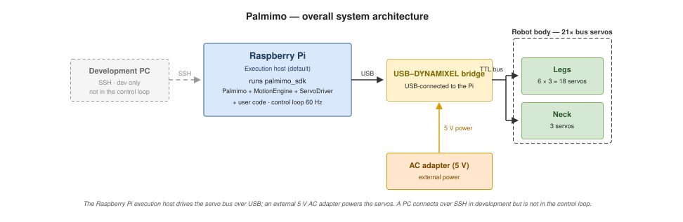
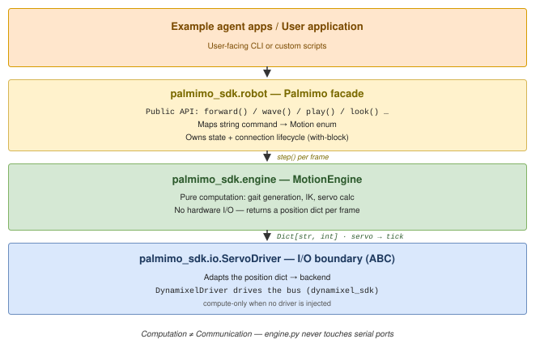
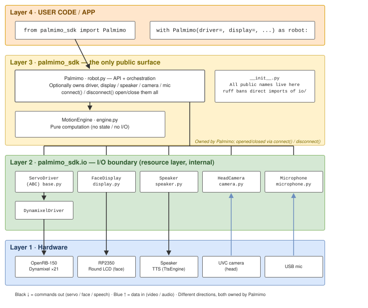

# システムアーキテクチャ

このドキュメントは、卓上サイズの 6 本脚ロボット「Palmimo DevKit」のシステムアーキテクチャを説明します。

> `palmimo_sdk` の `robot.py` ファサード + `engine.py` 計算層 + `ServoDriver` 抽象化について、現在の構造とその設計意図（なぜこのように層を分けるのか）を扱います。

## システム全体のアーキテクチャ

以下に概要を示します。



電源は外部から供給し、計算は Raspberry Pi が担当します。DevKit は **Raspberry Pi 5（16 GB**）を制御ホストとして搭載し、サーボは 5 V DC アダプター、Pi は専用の USB PD 電源で動きます。内蔵バッテリーはありません。開発中は PC をホストとして使うこともできます（後述）。

## 実行モデル

既定の実行ホストとして Raspberry Pi を想定しています。制御ループ（歩容生成 → サーボ書き込み、60 Hz）はすべて Pi 上で実行し、Pi は USB シリアルで OpenRB-150（USB–DYNAMIXEL ブリッジ）に直接接続します。サーボとの往復通信がネットワークを通らないため、ループはネットワーク遅延やジッターの影響を受けません。開発中は PC から SSH などで接続しますが、PC は制御には関与しません。

| 層 | コンポーネント | 役割 |
|---|---|---|
| 開発マシン | PC（SSH など） | 編集、起動、ログ閲覧。制御には関与しません |
| 実行ホスト | Raspberry Pi（既定の想定） | `palmimo_sdk`（`Palmimo` + `MotionEngine` + `ServoDriver`）とユーザーコードを実行します |
| インターフェースボード | OpenRB-150 | Pi に USB 接続します。USB–DYNAMIXEL ブリッジとして書き込み済みの状態で出荷し、サーボコマンドをバスへ中継します |
| アクチュエーター | シリアルバス式スマートサーボ 21 個 | 脚 18 個 + 首 3 個。Protocol 2.0 / ボーレート 1,000,000 |

## ソフトウェアアーキテクチャ



### データフロー

1. ユーザーが `robot.forward()` を呼ぶ → Motion 列挙型を設定します
2. `robot.step()` を呼ぶたびに → MotionEngine がサーボ位置を計算します
3. `Dict[str, int]`（servo_name → tick_value）を返します
4. ServoDriver が位置をバスへ送ります（ドライバーが注入されていない場合は計算のみです）
5. 目標 fps（既定値 60）で繰り返します

### 主な設計原則

- **計算と通信の分離**: engine.py はシリアルポートに一切触れません
- **ニュートラルの契約**: すべてのモーションはニュートラル姿勢で始まり、終わります。 `neck_pitch1` 以外のすべての関節はサーボの生のニュートラル値（2048）です。この関節はエンジンの静止姿勢用トリムを適用した中心に落ち着きます（[api-reference.md](../reference/api-reference.md) の `neck_rest_pitch_deg` の調整を参照）。`neck_pitch2` には独自のトリムがなく、生のニュートラル値に落ち着きます
- **フレーム単位**: step() は毎回、サーボ位置の 1 フレームを生成します
- **決定的**: 同じモーション + 同じ位相 = 同じ出力です（ハードウェアなしでテストできます）
- **軽量なコア**: SDK の基本依存関係は `pyserial` だけです。それより重いインポートはすべて extra の内側に置くため、`import palmimo_sdk` に必要なのは `pyserial` だけです。 TTS 合成は差し替え可能で（`TtsEngine`、既定は `piper-plus` を使う `PiperEngine`）、`speech` extra の内側にある `palmimo_sdk.io.tts` に置きます。`palmimo_sdk.io.speaker.Speaker` 自体はエンジンに依存せず、キュー管理と再生だけを担当します。共有マイク取り込み、GTCRN ノイズ除去、DTLN-AEC エコーキャンセル（`palmimo_sdk.audio`）は `voice` extra の内側に置きます。その先の音声コマンド処理（VAD / KWS / ASR）は、これらの上に構築する呼び出し側の責任です。具体例は `examples/agents/wakeword` アプリを参照してください
- **`palmimo_sdk.io` が I/O リソースを所有**: ハードウェアとの境界はすべて `io/` 以下に集約します。サーボは `ServoDriver` / `DynamixelDriver`、カメラ取り込みは `HeadCamera`、マイク・スピーカー・ディスプレイは `Microphone` / `MicStream` / `Speaker` / `FaceDisplay` です。上位層はこれらを*利用する*だけで、バックエンドを自ら開くことはありません。`palmimo_sdk.io` は内部層です。利用側は `palmimo_sdk` のルートからインポートします（内部への直接アクセスは ruff TID251 で禁止しています）。重いバックエンド（`dynamixel_sdk` / `cv2` / `piper` / `pyserial` / `sounddevice`）は遅延インポートするため、モジュール自体のインポートはハードウェアに依存しません。これにより、利用側ごとに同じ取り込み処理が重複するのを防ぎます（画像の*処理*はアプリ、*取り込み*は SDK に置きます）。 `MicStream` は、複数の利用側で 1 つの物理マイクを共有するリソースです（常時稼働する VAD、必要時の ASR 取り込み、ノイズ除去器など）。バックグラウンドスレッドで 1 つの `sounddevice.InputStream` を開き、各チャンクをすべての `subscribe()` 済みの利用側へ配信します。`Microphone` と `MicStream` が同じ物理マイクを指すことは、両方に同じ `device_key` 文字列を与えるという*規約*だけで表現します（デバイスの同一性を照合する仕組みはありません）
- **`palmimo_sdk.audio` は純粋な処理層**: `io` がハードウェアを所有して生のバイト列や配列を返す一方、`audio` はサンプルストリームを変換するだけで、I/O を持ちません。 `engine.py` がサーボ I/O を持たないのと同じ分離です。GTCRN ノイズ除去（`denoise.py` の `SpeechDenoiser` / `StreamingDenoiser`）と DTLN-AEC 音響エコーキャンセル（`dtln.py` の `DtlnResidual` / `GatedDtlnCanceller`）は両方ともここに置き、`sherpa_onnx` / `ai-edge-litert` / `numpy` を遅延インポートします。`AudioProcessor` （WAV バイト列を受け取り、モノラル WAV バイト列を返す `Protocol`）は、`MicStream` / `Microphone` が取り込んだ音声を通す DI の接点です。任意の数の処理器を直列に接続できますが、入力に複数チャンネルを要求できるのは最初の処理器だけです（`capture_channels` 規約）。`Denoiser` は、この契約の内側で `StreamingDenoiser` を包みます。`EchoCanceller`（`aec.py` 内）も同様に `GatedDtlnCanceller` を包み、マルチチャンネル WAV（マイク + スピーカーの参照信号）を受け取って、モノラルを出力します。`MicStream` の既定値は `processors=[EchoCanceller()]` です（生の音声には `[]` を指定します）
- **ファサードが周辺機器をまとめて所有**: ファサードはドライバーと対称的に周辺機器を `Palmimo(display=..., speaker=..., camera=..., mic=...)` として所有します。 `connect()` / `disconnect()` で、サーボバスと一緒に開閉します。 `connect()` は接続済みドライバーを自動でウェイクし、`disconnect()` は閉じる前にパーク（ニュートラルへの復帰 + 首のソフトリリース）します。すべての周辺機器は任意です。デバイスがなければ、`set_expression()` / `say()` は何もせず `None` を返します（上位層は物理層が存在するかどうかを知る必要がありません）。ある周辺機器を開いた後に別の周辺機器を開くのに失敗すると、すでに開いたものを閉じてからエラーを再送出するため、部分的な失敗でポートを開いたままにしません。 `set_expression()` / `say()` と違い、`HeadCamera` / `Microphone` の読み取りメソッドはファサードに追加しません。1 つの物理デバイスに複数の読み手があり得るためです（カメラなら VLM の観察と手振りの監視）。利用側は `robot.camera` / `robot.mic` を通じて直接読み取りや録音を行います（`robot.driver.write_positions` と同じ形です）

### 周辺機器の所有



`Palmimo` は、ドライバーと `FaceDisplay` / `Speaker` / `HeadCamera` / `Microphone` を任意で所有し、`connect()` / `disconnect()` でまとめて開閉します。データは双方向に流れます。サーボ・表情・発話はコマンドを*送り*、カメラ・マイクはデータを*取り込みます*。ただし、**方向は所有者を決めません**。どちらも `Palmimo` が所有します。

`Microphone` は、1 回の録音内でやり取りが完了するアプリが使います。 SDK は `MicStream`（共有ストリーミング取り込み）と `palmimo_sdk.audio` （GTCRN ノイズ除去、DTLN-AEC エコーキャンセル）も提供するため、生のチャンクの取り込み、ノイズ除去、エコーキャンセルはすべて SDK に任せられます。VAD / KWS / ASR 自体は呼び出し側の責任であり、SDK はそこまで担当しません。独自のストリーミング VAD + ASR スタックを動かし、SDK のマイクを使わないアプリは、`mic=None` のままにします。ファサードは「所有できますが、強制しません」。これは他のすべての周辺機器とまったく同じ扱いであり、マイクだけが特別なのではありません。

### リソース予約の境界

デバイスを開くバックエンドは、その論理リソースの予約も所有します。 `DynamixelBus` は `servo_bus`、`HeadCamera` は `camera`、`Microphone` と `MicStream` は `microphone`、`Speaker` は `speaker`、`FaceDisplay` は `display` を所有します。ファサードはこれらの所有者に委譲し、後から開く処理が失敗した場合は、既存のロールバック処理で先に開いたリソースを閉じます。そのため、アプリ、診断ツール、MCP の利用側は、ファサード層で別のロックを取らずに、同じ調停を共有できます。

`palmimo_sdk.reservation` は、非ブロッキングのアドバイザリ `flock` ロックを使います。 OS プロセスが終了すると、SIGKILL の場合も含めて解放されます。プロセス内の参照カウントにより、複数のバックエンドインスタンスが同じリソースの使用意図を表せます。最後の参照が解放されるまで、他のプロセスは排除されます。この調停は、マイクレジストリによるプロセス内のストリーム委譲を置き換えるものではなく、複数のハードウェアハンドルを安全に同時操作できるようにするものでもありません。SDK の外でデバイスを直接開くコードは参加せず、fork された子プロセスが継承したロックの寿命を延ばす場合もあります。

予約は、再生や録音をしていない間も維持します。後処理で予約を解放するのは、デバイスハンドルを閉じた後だけです。そのため、時間制限付きのカメラやマイクのクローズがブロック中の読み取りを放棄しても、遅延クリーンアップが成功するまで排他性を保ちます。ロックファイルは削除せずに保持し、すべての待機側が同じ inode を使い続けられるようにします。`/run/lock/palmimo` 以下の共有ストレージにより、ローカルユーザーはグループへの所属やイメージ固有の設定なしで調停できます。新規ディレクトリにはスティッキービットを付け、全ユーザーが書き込めるようにします（`1777`）。ファイルは全ユーザーが読み書きできます（`0666`）。ディレクトリは共有権限の設定後に公開するため、予約パスに設定途中のディレクトリが見えることはありません。ロックを開く際はシンボリックリンクを拒否し、記述子が通常ファイルを指すことを検証してから、ロックやメタデータの書き込みを行います。既存ファイルを `O_CREAT` なしで開くことで、 Linux の `fs.protected_regular` の下でも協調できます。共有ディレクトリが使えない場合は、予約を黙って個別の一時ストレージに分散させず、失敗させます。API、ストレージ、エラーの契約は、[リソース予約](../reference/api-reference.md#リソースの予約)を参照してください。

### パッケージ構成

uv 管理のワークスペースに SDK コアを置き、メンバーは `palmimo_sdk` だけです。 `examples/` 以下の各サンプルは、`Palmimo` ファサードを通じて SDK を利用します。ただし、ワークスペースのメンバーではなく、公開済みの `palmimo-sdk` パッケージに依存する独立した uv プロジェクトです。 [examples/README.md](../../../examples/README.md) を参照してください。依存関係は常に一方向で、コアがその上に構築されたパッケージをインポートすることはありません。

```
pyproject.toml                          # uv workspace root
packages/
  palmimo_sdk/                             # Core SDK — the single user-facing window
    palmimo_sdk/
      __init__.py                       # Re-exports Palmimo / Motion / RoutineStep / MotionEngine / ServoDriver / DynamixelDriver / kinematics / palmimo_motor_ids / SUPPORTED_MOTOR_MODELS
      robot.py                          # Palmimo facade — public API + connection lifecycle
      _leg_safety.py                    # LegSafety — one leg telemetry sweep judged by the overload and rail guards
      engine.py                         # MotionEngine — pure gait/IK computation, no I/O
      kinematics.py                     # Shared IK/FK (leg_ik / servo ticks / body-frame foot position)
      io/__init__.py                    # Re-exports ServoDriver / DynamixelDriver / HeadCamera / Microphone / MicStream / Speaker / FaceDisplay / find_servo_port
      io/base.py                        # ServoDriver ABC (I/O boundary) + ServoTelemetry / ServoPositions
      io/dynamixel.py                   # DynamixelDriver — concrete ServoDriver over the Dynamixel bus (+ find_servo_port auto-detection)
      io/camera.py                      # HeadCamera — head-camera capture resource (full-FOV MJPG -> downscale -> rotate)
      io/microphone.py                  # Microphone — USB mic capture (arecord/rec → WAV bytes)
      io/mic_stream.py                  # MicStream — shared streaming mic capture (background thread, fan-out to subscribers)
      io/_mic_registry.py               # Process-local device_key registry coordinating Microphone <-> MicStream ownership
      io/speaker.py                     # Speaker — non-blocking TTS orchestration (queue/worker/barge-in), delegates synthesis to a TtsEngine
      io/tts/base.py                    # TtsEngine ABC / TtsVoice protocol — the synthesis-engine boundary
      io/tts/piper.py                   # PiperEngine — the default TtsEngine, over piper-plus (MIT)
      io/display.py                     # FaceDisplay — host-side client for the RP2350 face display (USB-CDC)
      audio/denoise.py                  # SpeechDenoiser / StreamingDenoiser — GTCRN (sherpa-onnx) noise removal, pure sample transforms
      audio/dtln.py                     # DtlnResidual / GatedDtlnCanceller — DTLN-AEC (ai-edge-litert) echo cancellation, pure sample transforms
      audio/aec.py                      # EchoCanceller — AudioProcessor implementation wrapping GatedDtlnCanceller
      audio/processor.py                # AudioProcessor protocol (WAV in/out, DI/cascade) + Denoiser/ClipDenoiser + int16_to_wav/wav_to_int16/wav_to_int16_multi
    tests/                              # engine / robot / driver / kinematics tests
examples/
  agents/
    wakeword/                              # Wake-word voice agent example (Silero VAD + Whisper STT + LLM tool-calling)
    companion/                             # Always-on companion agent example (idle loop + speech/vision-driven responses, LLM tool-calling)
    openclaw/                              # Connection kit for driving Palmimo from OpenClaw (self-hosted AI assistant) over the MCP server
scripts/                                # Supported user diagnostics (diagnose_servos: scan / power / errors / joints / recover / oscillate)
```

### 依存関係

- `pyserial>=3.5` — SDK 唯一の基本依存関係（シリアルポート通信）
- その他はすべて [`packages/palmimo_sdk/pyproject.toml`](../../../packages/palmimo_sdk/pyproject.toml) の extra の内側にあります。 `hardware`（`DynamixelBus` を通じたサーボ通信プロトコルの `dynamixel-sdk`）、 `face`（`FaceDisplay` 用の `pyserial`）、`speech`（`piper-plus` TTS）、`voice` （マイクストリーミングとノイズ除去/AEC — `sounddevice`、`numpy`、`sherpa-onnx`、 `ai-edge-litert`）、`agent`（LLM ツール呼び出し層の `pydantic`）、`vision` （`HeadCamera` 用の `opencv-python`）、`mcp`（`mcp`、`mcp-types`、`starlette`、 `uvicorn` と `agent`）です
- `tqdm>=4.66.0` — このリポジトリ自身の `scripts/` の依存関係であり、 SDK パッケージの依存関係ではありません

## 設計意図（なぜこのように層を分けるのか）

1. **ハードウェアに依存しない SDK の入口** — モーターライブラリを直接使うと、呼び出し元が内部実装に結合します。`palmimo_sdk` を唯一の窓口にすることで、ユーザーが知る必要があるのは `Palmimo` ファサードだけになります
2. **モーション計算と I/O の分離** — 歩容生成、IK、その他のモーション計算は `MotionEngine` に閉じ込め、計算結果（サーボ位置）だけを Driver に渡します。計算層はハードウェアなしでテストできます
3. **ドライバーの抽象化** — 将来のバックエンドに備え、I/O を `ServoDriver` ABC の内側にカプセル化します
4. **軽量なコア** — 重いオプション依存関係（voice / tts）は extra の内側に置きます。 `import palmimo_sdk` に必要な基本依存関係は 1 つ（`pyserial`）だけです。その上に構築するアプリレベルの処理は `examples/` のアプリに置きます（これは OSS ライブラリとして配布する前提でもあります）

上のソフトウェアアーキテクチャ図に示すとおり、入口となるクラス `Palmimo` はモーション計算を `MotionEngine` に委譲し、I/O は `ServoDriver` の内側にカプセル化します。基本方針は、**計算（歩容 / IK）と通信（シリアル）を別の層に分けること**です。

- **`robot.py`（`Palmimo`）= 状態とオーケストレーション** — ユーザー向け API と接続ライフサイクル（`with` ブロックによる制御）を持ちます。`connect()` はリソースを開き、ドライバーが接続済みなら、`auto_wake=False` で構築した場合を除き、 `wake()` の滑らかな移動（脱力 → ニュートラル）を自動実行します。`disconnect()` は閉じる前にロボットをパークします（ニュートラルへの復帰後、首をソフトリリースするランプ）。 `__exit__` は `disconnect()` に委譲します。正常終了では完全にパークしますが、例外の後は首のソフトリリースだけを実行します（エラーを隠したり、不正かもしれない状態で動かしたりしないよう、モーションコマンドは飛ばします）。計算は `MotionEngine`、I/O は `ServoDriver` に委譲します
- **`engine.py`（`MotionEngine`）= 純粋な計算** — コマンドとフレームだけからサーボ位置を計算して返します。状態を持たず、I/O も行いません（ハードウェアなしでテストできます）
- **`io/`（`ServoDriver` + 具象ドライバー）= I/O 境界** — 計算済みのサーボ位置をバックエンドに送り続けます。`dynamixel_sdk`（`DynamixelBus`）は、オプションの extra（`palmimo-sdk[hardware]`）を通じて遅延インポートするため、コアはハードウェアに依存しません

モーションの選択（`forward()` など）と実行（`run(seconds=)` / `run(steps=)`）を分けることで、制御フレームを自分で数えずに「何秒 / 何ステップ」と指定でき、制御レート（`fps`）は `Palmimo` に集約されます。

`run()` は、別スレッドで動く呼び出し元がロボットに割り込める唯一の場所でもあります。 `Palmimo.cancel()` は小さなロックの下で内部カウンターを増やします。別スレッドから安全に呼べる唯一のファサードメソッドとして文書化されています（ほかの状態には触れないため、モーションループ自身の読み書きと競合しません）。ペーシングを行う各公開メソッド（`run()` / `perform_dance()` / `play_realtime()`）は、入った瞬間にカウンターのスナップショットを取ります。3 つが共有するペーシングループ `_pace()` は、フレームごとに 1 回、現在のカウンターとそのスナップショットを比較します。増えていればそこで `MotionCancelled` を送出し、ブロッキング呼び出しが自然に終わるのを待たず、ほぼ 1 フレーム周期以内にスタックを巻き戻します。`perform_dance()` 独自の、ペーシングしない終端保持とホームへの滑らかな復帰の区間では、同じカウンターを短い間隔でポーリングし、キャンセルが外へ伝播する前に必ず `stop()`（IDLE）を実行します。入口でスナップショットを取ることで（以前の設計のようにペーシングループの開始時に `threading.Event` をクリアするのではなく）、待機中に偶然届いた `cancel()` が次の呼び出しに持ち越されず、同じ入口でクリア可能な `Event` に生じる clear()/set() の競合も避けられます。

ペーシングする呼び出しをインラインで呼ばず、別スレッドへ振り分ける呼び出し元には、もう 1 つ塞ぐべき隙間があります。振り分けた後、ワーカースレッドが実際にペーシングメソッドの入口へ到達する前に `cancel()` が届くと、通常はそのメソッドの入口のスナップショットに取り込まれてしまいます。`Palmimo._arm_cancel_scope()` / `_disarm_cancel_scope()` は、この隙間を構造的に塞ぎます。arm は振り分けの直前に現在のカウンターを有効化時の基準値として記録し、ワーカーが最初に到達したペーシングメソッドが、カウンターを新たに読む代わりに、その値を（`_take_cancel_snapshot()` 経由で）自分自身の入口のスナップショットとして消費します。これにより、有効化以降のどの時点で届いた `cancel()` も、必ず `MotionCancelled` を送出します。`AgentToolSet.call()` は、ツールの `execute()` をワーカースレッドへ渡す前に arm し、そのワーカーが終わると `finally` で disarm します。エージェントのツールセットを通るすべての処理で、隙間を端から端まで塞ぎます。

## 安全設計

この節は、[AGENTS.md](../../../AGENTS.md) のハードウェア安全性の節を、SDK の設計の観点から具体化します。基本方針は、制御が止まったり SSH セッションが切れたりしても、安全側に倒すことです。

- **安全なサーボ範囲** — 200〜3900 tick を厳格に適用し、機械的な限界（0 / 4095）を避けます（`io/base.py` の `ServoDriver.write_positions` でクランプするため、 Dynamixel だけでなく、すべてのバックエンドに適用します）
- **起動時のニュートラル姿勢** — 接続とスクリプトの起動は、常にニュートラル姿勢から滑らかに始めます。急な飛びは禁止です
- **サーボのテレメトリ** — `ServoDriver.read_telemetry()` は、現在の電流、入力電圧、温度を 1 回のバス走査で読み取ります（`io/base.py`、`io/_dynamixel_bus.py` の範囲読み取りで実装）。信号ごとに 1 回ずつ読むのではなく、1 回の走査にまとめることで、ガードは制御ループのフレーム予算内でサンプリングできます。応答しないモーターは未読み取りとして報告し、ゼロとはしません。架空の読み取り値は健全である証拠と受け取られてしまうためです。現在位置も同じ範囲に含まれ、バス時間は増えません。両方のガードは `telemetry.py` の `TelemetryPoller` を通じて読み取ります。これがポーリング間隔と、読み取れないときの意味を管理するため、両者にずれが生じません
- **トルクを切らず、モーションを止める** — ガードが作動するとき、意図する対応はモーションを終了し（`motion → IDLE`）、トルクは入れたままにすることです。サーボのトルクを切るとその関節は脱力し、立っているロボットの関節が脱力すれば倒れます。これは防ごうとしている異常より悪い結果です。サーボ自身のファームウェアが最後の遮断手段であり続けます。首のサーマルガード（過熱保護）も同じ規則に従い、`HOT` では何かを切るのではなく、モーション（首を中心へ）を強制します（後述）。唯一の意図的な例外は、つかまれた腕への過負荷ガードの反応です。次に説明します
- **脚の電流には対処します**（`overload.py` の `OverloadGuard`。`Palmimo.step()` から `_leg_safety.py` の `LegSafety` を通じて最大 30 Hz でポーリングします）。脚の軸がつかまれたり妨げられたりすると、サーボが自身の Overload エラーをラッチして脱力するまで電流を消費し、胴体が予測できない形で倒れます。先に止めることで、ロボットはどこで終わるかを選べます。チャンネルごとのしきい値以上のサンプルが 3 回連続すると、モーションを `IDLE` に落とします。 0.2 s 以上離れたサンプルは連続と数えないため、ステップの休止前に残った連続回数を新しいものと合算しません。後述の電源レールガードも同じ規則に従います。 `LegSafety` が読み取りと判定を行い、どのモーションでどの腕の軸を柔らかくするかも扱います。`robot.py` は反応（モーションの停止、ソフト復帰のゲインの書き込み）を担当します。手振りで持ち上げた腕は、「トルクを入れたまま」の例外です。人がつかむと硬いサーボと力が競合するため、腕でトリップした場合、その腕だけを柔らかいゲインに下げてニュートラルへゆっくり戻します。ゲインを書き込めない場合に限り、トルクを切ります。このソフトゲインは、`robot.py` のジェスチャー調整の同期における追加の状態です。そうしないと、次のフレームで手振り用の調整が解放されたときに上書きされるためです。脚のトリップではゲインに触れません。腕が戻ったかどうかは、電流ではなく位置で判断します。つかまれた腕は、ソフトゲインでは電流が小さくても、ニュートラルから離れたままだからです。バスの読み取りは応答しない最初の軸で止まるため、`TelemetryPoller` は 3 回連続の走査で無応答だった軸を外し、1.5 秒ごとにその軸だけを再確認します。そうしないと、サーボが 1 つ壊れているだけで、その後ろの軸がすべてのガードから見えなくなります。外した軸は健全ではなく不明として扱い、変化は記録とログに残すだけで、何も作動させません。しきい値、トリップ API、首のガードと同じ適用範囲については、 [API リファレンス](../reference/api-reference.md#過負荷ガード)を参照してください
- **電源レール電圧には対処します**（`rail.py` の `RailGuard`。過負荷ガードと同じ 30 Hz の脚のテレメトリ走査から値を受け取り、バスの追加読み取りは行いません）。合計電流が高いと、電源経路の抵抗によって、すべての軸の入力電圧が一緒に下がります。電圧低下が続くと、サーボは Input Voltage エラーをラッチしてトルクを切ります。このとき各軸自身の電流は制限内にあるため、軸ごとの過負荷ガードでは検出できません。すべての軸は同じ電源レールを測るため、ガードは走査の最低電圧を、軸ごとではなく胴体全体の 1 つの信号として扱います。 3.8 V 未満の走査が 6 回連続すると（200 ms、60 fps でポーリングが 1 フレームずれると最大約 300 ms）、モーションを `IDLE` に落とします。トルクは入れたままで、ゲインには触れません。連続回数はモーションではなく電源レールに属するため、モーションが変わっても維持します。組み立て済みロボットで全モーションを測定したところ、通常歩行中に 3.8 V 未満となる最長区間は 67 ms で、サーボの Min Voltage Limit は 3.5 V です。電圧低下時にサーボがどれだけ早くラッチするかは未測定なので、ラッチより先にガードが作動するとは主張しません。 [API リファレンス](../reference/api-reference.md#電源レールの低電圧ガード)を参照してください
- **脚の温度は報告しますが、対処はしません** — すでに熱い脚のサーボは、ガードが反応する速さでは冷えないため、モーションを終了する効果は小さいからです。また、8 時間の展示日の間、これらのサーボは約 50 °C と測定され、定格の範囲に十分収まっていました。読み取り値は公開し、停止の判断は室内の状況や予定を把握できる操作者に任せます。値に応じて作動する処理はありません
- **首の温度には対処します**（`thermal.py` の `NeckThermalGuard`。`Palmimo.step()` から 1 秒に 1 回ポーリングします）。立脚相にだけ荷重を受ける脚とは異なり、首は常に頭を支えます。姿勢を保持し続けた結果、71 °C で Overheating HW エラー（bit 2）をラッチしてトルクを切る様子が観測されています（2026-09）。これは、前述の操作者による監視という考え方では対処できません。歩容を見るのと同じようには、保持された視線角度を誰も監視しないためです。 `HOT`（62 °C 以上）では、首を強制的に中心へ戻し（`look()` だけでなく、首を書き込むすべての経路が対象です。`MotionEngine.neck_hold_center` を参照）、NOD/HEAD_SHAKE は `IDLE` に落とします。モーションは変えますが、トルクは入れたままです。首が 55 °C 以下に冷えるまでこれを維持します（ヒステリシスにより、境界付近の温度でポーリングごとにロックアウトが切り替わるのを防ぎます）。テレメトリ走査で首のモーターが欠けた場合は、推測せず最後の判定を維持します。値が古くなる（`NECK_STALE_S`）と、 `neck_thermal_state` は `UNMONITORED` を報告し、現実を反映しなくなった可能性のある読み取り値を信用しません。ただし、古くなる前に HOT だった場合、ロックアウト自体（`neck_lock_active`）は維持します。観測できない首は、まだ熱いかもしれないためです。ロックアウトを解除するのは、切断時か、新しい走査で 55 °C 以下になったときだけです。完全な状態表は、[API リファレンス](../reference/api-reference.md#首のサーマルガード過熱保護)を参照してください。脚は、前述の報告だけの動作を維持します。**適用範囲**: ガードが届くのは `Palmimo.step()` を通る呼び出し元だけです（`run()`/`play()`、MCP サーバー、エージェントのツール層）。LeRobot の遠隔操作連携はエンジンを直接動かすため、対象外です。`step()` を通さずにドライバーへ直接書くソフトウェアの滑らかな移動（`Palmimo.wake()`、 `_timed_return_to_neutral()`）も対象外ですが、首をニュートラルまたは中心の目標へ向けて動かすだけで、離すことはないため、この隙間にはガードが防ぐべき危険がありません。

  以前の設計では、`HOT` より上の `CRITICAL` しきい値で、ガードが首をソフトリリースする（ゲインを徐々に下げる）処理もありました。 2 回目の敵対的レビューで、その仕様は安全でないと分かりました。同じ接続内の別の場所（`wave()`、`dance()`、`perform_dance()`）でフルゲインを書き込むと、全モーターのゲインを再び有効化して、解放を黙って取り消してしまいます。また、解放後にフルゲインへ戻すと、滑らかに回復する代わりに、保持姿勢へ 1 ステップで大きく飛びます（最大約 25°）。さらに、その追加状態を正当化できる、首が実際にどれだけ速く熱くなるかの測定データもありませんでした。そのため、出荷せずに削除しました。前述の `HOT` でモーションを止める反応が、ガードのすべてです。
- **制御の喪失は、読み取り値に対する保護とは別の場合です** — バスの切断、ステータスパケットの異常、ループの停止が起きると、終了させるモーション自体がなくなります。その場合の代替動作は、ロボットが荷重を支えているかどうかに応じて、トルクを切る（脱力する）か、安全に保持することです。これは前述のトルク維持と矛盾しません。ガードは制御が機能している間に作動し、こちらは機能しなくなった場合の処理です

## I/O 実行環境の要件

`palmimo_sdk` のコアはハードウェアに依存しませんが、実際の I/O を動かす実行ホストには、既定で Raspberry Pi を想定し、次の前提条件を設けています。

- **OS** — 64-bit Linux（aarch64、例: Raspberry Pi OS）。`uv` と `dynamixel_sdk` の依存関係を解決できることが必要です
- **ランタイム** — `uv`（[ソフトウェアのセットアップ](../guides/installation.md)が成功する必要があります）
- **シリアルの権限** — 実行ユーザーが `dialout` グループに所属していること
- **デバイス名** — `udev` による安定した OpenRB-150 のポート名（USB の抜き差しで番号が変わらないよう固定します）
