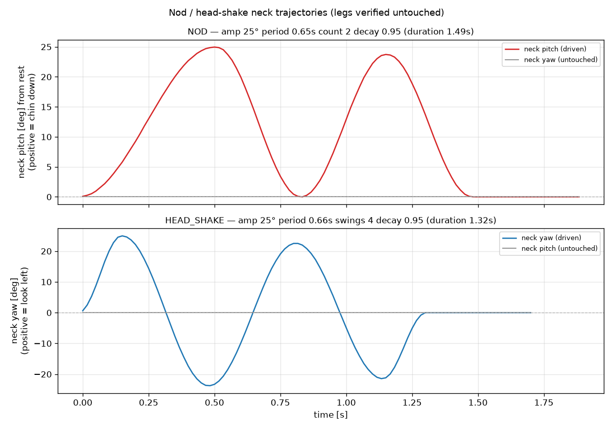

# API リファレンス — Palmimo

## インポート

```python
from palmimo_sdk import Palmimo

robot = Palmimo()
```

## モーションコマンド

| メソッド | Motion 列挙型 | 文字列エイリアス |
|--------|-------------|----------------|
| `robot.forward()` | FORWARD | "forward" |
| `robot.backward()` | BACKWARD | "backward" |
| `robot.strafe_left()` | STRAFE_LEFT | "strafe_left" |
| `robot.strafe_right()` | STRAFE_RIGHT | "strafe_right" |
| `robot.rotate_left()` | ROTATE_LEFT | "rotate_left" |
| `robot.rotate_right()` | ROTATE_RIGHT | "rotate_right" |
| `robot.creep()` | CREEP | "creep" |
| `robot.dance()` | DANCE | "dance" |
| `robot.body_tilt()` | BODY_TILT | "body_tilt", "tilt" |
| `robot.pushup()` | PUSHUP | "pushup", "push_up" |
| `robot.wave()` | WAVE | "wave"（右脚）、"wave_right"（FR）、"wave_left"（FL） |
| `robot.nod()` | NOD | "nod" |
| `robot.head_shake()` | HEAD_SHAKE | "head_shake", "shake_head" |
| `robot.wave_both()` | WAVE_BOTH | "wave_both" |
| `robot.clap()` | CLAP | "clap" |
| `robot.bow()` | BOW | "bow" |
| `robot.stretch()` | STRETCH | "stretch" |
| `robot.stop()` | IDLE | "idle", "stop" |

各モーションの動作は[モーション一覧](motions.md#利用可能なモーション)を参照してください。以下では、API レベルで関係する動作のみを説明します。

`wave` / `wave_right` と `wave_left` は、右前脚または左前脚を選びます。振り付けを `play([("wave_left", s)])` の形式で指定する場合も同じです。調整済みの振り付けを一度再生し、その後はニュートラル姿勢を維持します。

`nod` / `head_shake` は、首だけを動かす単発のジェスチャーです。最初の動きは最初のフレームから始まります（予備動作がないため、表情と同時に実行できます）。ジェスチャー開始時に頭が別の方向を向いていた場合は、急に動かすのではなく、最初の 0.2 秒で中央へ滑らかに戻します。どちらも一度再生し、その後は中央を維持します。調整項目は「うなずき / 首振りジェスチャーの調整」を参照してください。

`wave_both` / `clap` は、どちらも最初に「おねだり」姿勢を取ります。この姿勢では、前脚が空中にある間、中脚と後脚による支持四角形の前縁を重心より前に保ちます。どちらも一度再生し、その後はニュートラル姿勢を維持します。

`bow` / `stretch` は、ゆっくり姿勢を変える単発のジェスチャーです。終了後に同じモーションを選び直すと最初から再生します。ジェスチャーの途中で選び直しても無視します（負荷がかかった状態で急に動くのを防ぐためです）。途中で別のモーションに切り替えると（例: `stop()`）、脚とともに首も中央へ戻ります。ジェスチャーが終わると、首の制御は再び `look()` に戻ります。ストレッチ中は、ファサードが脚に速めのプロファイル（Profile_Velocity 120）を適用し、終了時にドライバーに設定されたデフォルトへ戻します。これは手振りの軸ごとの自動調整と同じ仕組みです。調整項目（`bow_depth`、`bow_hold_s`、`stretch_fold_deg`、…）はエンジン上にあり、 `robot.engine.bow_depth = 26.0` のように設定します。デフォルトは意図的に浅く、転倒しにくい値です。`engine.py` の `_BOW_*` / `_STRETCH_*` ClassVars を参照してください。特に `stretch_fold_deg` は、実機で少しずつ上げてください。脚を折り畳む動きでは膝が IK モデルの公称範囲を超えますが、その物理的な限界はモデル化されていません。

`dance()` は身体を連続的に揺らすモーションです（`step()` / `run()` で実行します）。デモアプリのデフォルトで、ほかのモーションと同様、停止されるまで続きます。数回揺れ、保持し、滑らかに元へ戻る完結した単発の演技には、 `perform_dance()` を使います（「ダンスの調整」を参照）。デモでは `--dance-oneshot` でこの演技を再生します。

## コアメソッド

### `robot.step() -> Dict[str, int]`
1 フレーム進めます。サーボ位置を `{name: tick_value}` として返します。

### `robot.step_n(n: int) -> list[Dict[str, int]]`
N フレーム進めます。位置辞書のリストを返します。

### `robot.set_motion(name: str) -> bool`
文字列名でモーションを設定します（`_MOTION_MAP` を検索します）。`name` が `"nod"`/`"head_shake"` で、`robot.neck_lock_active` が `True` の場合は、モーションを変えずに `False` を返します（[首のサーマルガード（過熱保護）](#首のサーマルガード過熱保護)を参照）。それ以外は `True` を返します。

### `robot.run(*, seconds: float | None = None, steps: int | None = None) -> Dict[str, int]`
現在のモーションを一定時間実行します。処理はブロックし、ファサードの `fps` に合わせて実時間で進みます。`seconds`（`round(seconds * fps)` サイクルに変換）か `steps` のどちらか一方だけを渡してください。どちらも非負の値である必要があります。各サイクルは `step()` と同様、ドライバーへ送信し、`on_step` を発火します。最後のサーボ位置を返します（実行サイクル数が 0 の場合は現在の姿勢）。ペース制御しないループ（シミュレーション、テスト、独自のタイミング制御）には、可能な限り速く計算する `step()` / `step_n()` を使ってください。

```python
robot.forward()
robot.run(seconds=1.5)   # blocks ~1.5s, real-time paced
robot.stop()
```

別スレッドからキャンセルできます。後述の `robot.cancel()` を参照してください。 `run()` は開始直後、ほかの処理より先にキャンセルカウンターのスナップショットを取ります（アイドル中の `cancel()` が次の呼び出しに影響しないようにするためです）。その後、共通のペース制御ループ内で、フレームごとに現在のカウンターと比較します。その間に `cancel()` が実行されていれば、そこで `MotionCancelled` を送出します。 `perform_dance()` と `play_realtime()` も同じペース制御ループを共有し、各自の開始時に同様にスナップショットを取るため、`cancel()` で中断できます。 `perform_dance()` のペース制御を使わない終了時の保持や元の姿勢への復帰部分も含まれます。これらは独自の短い間隔で同じカウンターを確認します。

### `robot.cancel() -> None`
実行中の `run()`（または `perform_dance()` / `play_realtime()`）へ中止を通知します。次のフレーム境界で `MotionCancelled` を送出します。 `perform_dance()` とエージェントのツール層のモーションツールは、 `MotionCancelled` が伝播する前に、短い IDLE 送信で脚を滑らかに立ち姿勢へ移します。これにより、呼び出し元が次の動作を決める間、片方のトライポッドが歩行途中の曲がって負荷のかかった状態で止まったままになるのを防ぎます。

**ロボットを動かすスレッド（`run()`/`step()` を実行するスレッド）以外から安全に呼べる唯一の `Palmimo` メソッドです。** ほかのメソッドはすべて、呼び出し元が単一スレッドであると想定しています。`cancel()` は小さなロックの下で内部カウンターを増やすだけで、ファサードのほかの状態に触れないため例外です。モーションループ自身の読み書きと競合しません。

`clear()` される `threading.Event` ではなく、単調増加カウンターで実装しています。ペース制御する各公開メソッド（`run()` / `perform_dance()` / `play_realtime()`）は、呼び出された瞬間にカウンターのスナップショットを取り、その後の各フレーム境界で現在のカウンターと比較します。増えていれば、開始後に `cancel()` が実行されたと分かります。これは `Event` ベースの設計にある競合を防ぎます。古いキャンセルが次の呼び出しに影響しないよう、ペース制御ループの開始時にフラグをクリアすると、別スレッドの同時の `set()` と競合し、通知を黙って失う可能性があります。カウンターには競合の原因となる `clear()` 処理がないため、ペース制御するメソッドの開始から終了までのどこで `cancel()` が届いても、その呼び出し内で必ず `MotionCancelled` を送出します。

それでも残る唯一の隙間は、ペース制御するメソッドに入るより前の、呼び出し元側です。例えば、ワーカースレッドへ `run()` を割り当て、そのワーカーが実際に実行を始める前に別スレッドから `cancel()` を呼んだ場合です。このようにキャンセルと競合する呼び出し元は、結果を報告する際、`MotionCancelled` が送出されたかに頼らず、自分の `cancel()` 要求を正式な結果として扱う必要があります。

```python
import threading

robot = Palmimo()
robot.forward()
t = threading.Thread(target=lambda: robot.run(seconds=10))
t.start()
...
robot.cancel()          # from the main thread (or any other)
t.join()                 # the worker thread's run() raised MotionCancelled
```

キャンセル後にロボットを立ち姿勢へ戻したい場合は、`run()` の周囲で `MotionCancelled` を捕捉し、`finally` で `robot.stop()` を呼びます。これは `palmimo_sdk.agent.tools._run_motion` が、モーション途中のほかの失敗に対しても使っているパターンそのもので、その層で特別な処理は必要ありません。 `perform_dance()` 自身はこれを保証します。身体の揺れ、終了時の保持、元の姿勢への復帰のどの部分でキャンセルされても、`MotionCancelled` が伝播する前に `stop()` （IDLE）を実行するため、キャンセル後にファサードが DANCE のまま留まることはありません。 `MotionCancelled` は `palmimo_sdk` からエクスポートされています（`from palmimo_sdk import MotionCancelled`）。

### `robot.cancel_checkpoint() -> int`
単一の `run(seconds=...)` ではなく、`step()` / `run(steps=1)` の呼び出しを独自にペース制御する、自作の制御ループ向けの入口です。ループの先頭で一度呼び、戻り値を各反復の `raise_if_cancelled()` に渡してください。これにより、 `run()` の呼び出し内だけでなく、反復の間に届いた `cancel()` も検出できます。ペース制御する各メソッドの開始時と同様、開始時点からキャンセル監視の範囲を有効にする規則に従います。

### `robot.raise_if_cancelled(checkpoint: int) -> None`
`cancel_checkpoint()` で得た *checkpoint* 以降に `cancel()` が実行されていれば、 `MotionCancelled` を送出します。

### `robot.look(pitch: float | NeckPitchDegrees | NeckPitchNormalized = 0.0, yaw: float | NeckYawDegrees | NeckYawNormalized = 0.0) -> bool`
首を制御します。`robot.neck_lock_active` が `True` の間は、首の目標値を変えずに `False` を返します（[首のサーマルガード（過熱保護）](#首のサーマルガード過熱保護)を参照）。それ以外は `True` を返します。脚のどのモーション中でも呼べます。ピッチが正なら顎が下がります（2026-07 に実機で検証済み）。ヨーは、符号と回転方向の対応がまだ実機で検証されていません。各軸は 3 種類の形式を受け付けます。ピッチとヨーにはそれぞれ専用の値オブジェクト型があり、ヨーの値を `pitch=` に渡すと、黙って受け入れるのではなく `TypeError` を送出します。

- 通常の `float`/`int` — 正規化された [-1, 1] の値です。後方互換性のために維持している従来の契約です。範囲外の値は従来どおりエンジンがクランプします。
- `NeckPitchNormalized(value)` / `NeckYawNormalized(value)` — 同じ正規化された [-1, 1] の値で、その軸の首の機械的可動域に対する割合を明示します。自己検証し、[-1, 1] の範囲外では構築時に `ValueError` を送出します。
- `NeckPitchDegrees(value)` / `NeckYawDegrees(value)` — その軸の実際の首の角度です。内部で、その軸の実際の機械的可動域で割って変換します。ヨーは対称です（`MotionEngine.NECK_YAW_TRAVEL_DEG`、左右とも約 26.4°）。ピッチは現在、**非対称**です。顎を下げる側は `MotionEngine.NECK_PITCH_TRAVEL_DEG`（約 26.4°）、顎を上げる側（負の値）は、より大きい `MotionEngine.NECK_PITCH_UP_TRAVEL_DEG` （出荷時の `neck_rest_pitch_deg`/`NECK_PITCH2_SHARE` のデフォルトでは約 37.7°）を使います。理由は後述の `neck_pitch2` の段落を参照してください。自己検証し、その側の可動域を超えると構築時に `ValueError` を送出します。構築済みの値オブジェクトは範囲内にしか存在できないため、ファサード側でのクランプはありません。

`NeckPitchDegrees` / `NeckYawDegrees` / `NeckPitchNormalized` / `NeckYawNormalized` は `palmimo_sdk` からエクスポートされています（`from palmimo_sdk import NeckPitchDegrees, NeckYawDegrees, NeckPitchNormalized, NeckYawNormalized`）。変換はすべて `Palmimo.look()` 内で行います。`MotionEngine.set_neck()` が受け取るのは、引き続き正規化された float だけです。

首の構造は、本体 -> `neck_pitch1` -> `neck_pitch2` -> `neck_yaw` です。 `look()` のピッチ目標値は、すべてを `neck_pitch1` に負担させず、両方のピッチ関節に分配します（`MotionEngine.NECK_PITCH2_SHARE`、デフォルトは 0.5）。顎を下げる側では、頭全体のピッチ角は変わりませんが、各関節の振れ幅は小さくなります。これにより、実機の `neck_pitch1` の過熱が解消されました。顎を上げる側では、ピッチ目標値を両方の関節へ分配することで、`neck_pitch1` だけの場合よりも遠くまで頭を動かせます。`neck_pitch1` が自身の生の可動域の上限に達しても、`neck_pitch2` は自身の生の可動域全体を使って動き続けます。したがって、顎を上げる合計可動域は、 `neck_pitch1` の残りの可動域と `neck_pitch2` の全可動域の和になります（2026-09 の実機観察では、`neck_pitch1` だけでは、`neck_pitch2` にまだ十分な可動域が残っている段階で動かなくなりました）。`neck_pitch2` の tick の方向は `neck_pitch1` と同じです（`MotionEngine.NECK_PITCH2_SIGN = 1`、2026-09 に実機で確認済み）。 `nod()` は `neck_pitch1`、`head_shake()` は `neck_yaw` を動かします。どちらも、ジェスチャー前の視線位置を滑らかに元へ戻すのと同じ時間内に、`neck_pitch2` を生のニュートラルの休止位置へ滑らかに戻します。そのため、ジェスチャー前のオフセットに `neck_pitch2` を取り残すことなく、常に両方のピッチ関節が正面を向いてジェスチャーを終えます。

### `robot.look_center() -> None`
首を正面の休止位置へ戻します（`neck_rest_pitch_deg` で補正した中央です。「うなずき / 首振りジェスチャーの調整」を参照）。

### `robot.reset() -> None`
すべての状態を初期状態（アイドル、ニュートラル位置）へリセットします。

### `robot.wake(duration=1.5, start_gain=300) -> None`
脱力状態から起こします。脚の Position_P_Gain を *start_gain* からデフォルトへ徐々に上げながらニュートラル姿勢へ滑らかに移動します。急に動かず、柔らかく力を入れて立ち上がります。頭が落ちないよう、首は全期間にわたりフルゲインで保持します。ドライバーがゲインを徐々に変えられない場合は、通常の滑らかな移動にフォールバックします。

開始姿勢はモーターごとに読み取り、最初の一括読み取りで応答しなかったモーターには最大 3 回まで問い直します。それでも応答しないモーターがあれば、`wake()` はそのモーター名を示して `RuntimeError` を送出し、ドライバーへは何も書き込みません（ゲインも書きません）。推測した姿勢から滑らかに移動すると、それらの関節が急に動くためです。位置をまったく検知できないドライバーには、従来どおりニュートラルへの指令を 1 回だけ送ります。

`connect()` は、すべてのリソースが開いた後、これを自動実行します（`Palmimo(...)` のデフォルトは `auto_wake=True`）。`wake()` を直接呼ぶのは、独自の *duration* / *start_gain* を使う場合や、完全に再接続せずに起こし直す場合だけです。

### `robot.sleep(duration=1.5, end_gain=300) -> None`
`wake()` の逆です。脚の Position_P_Gain を *end_gain* まで徐々に下げながら、ニュートラル姿勢へ滑らかに移動します。その後、首を柔らかく解放して頭をゆっくり下ろします。デフォルトは `wake()` の開始点と同じなので、両者がつながり、起こすときに急な動きも沈み込みも生じません。*end_gain* は `(0, 900]` の範囲にしてください。0 では、脚にトルクがあっても保持力がなく、本体の下で折れ曲がります。

終了後のロボットは**柔軟に動ける状態で、完全停止ではありません**。トルクは *end_gain* で有効なまま、マイクとカメラも開いたままなので、眠っているロボットにも話しかけられます。パーク（安全姿勢に戻して脱力）してすべてを閉じる `disconnect()` とは、この点が異なります。

最初に、適用中の手振り / 首ジェスチャーの調整を解除します（後述）。移動中は首をその場で保持します。頭が天板に落ち着くと、目標値を実際に到達した姿勢へ書き換えます。これにより、次のゲイン書き込みで急な動きを生む誤差を残しません。脚のゲインは、実際の現在値から徐々に変えます。したがって、2 回目の `sleep()` でいったんゲインが上がることはありません。問い直しても読み取れないモーターがある場合は、滑らかな移動を省略します（そのモーター名を警告ログに出します）。ゲインの漸変、首の解放、パークはそのまま実行します。

機能が不足しても、目的を省略せずに機能を縮小します。位置を検知できないドライバーでも、ゲインの漸変と首の解放は行います（フィードバックが必要なのは滑らかな移動だけです）。ゲインを徐々に変えられないドライバーでも、滑らかな移動は行います。

睡眠中もモーション API は呼べます。眠っているロボットへ `forward()` を指示すると、頭を脱力させたまま *end_gain* で歩きます。`wake()` 以外にもゲインを上げる操作があります。手振りの調整は**すべて**のモーターへ `Position_P_Gain` を書き込み、 `set_p_gain()` も同じことをします。首の目標値が現在位置と一致しているので、どちらも頭を急に動かしませんが、ロボットは黙って硬くなります。先に起こしてください。

### `robot.return_to_neutral(max_steps: int = 120, settle_ticks: int = 2, *, duration: float | None = None) -> None`
すべてのサーボを滑らかにニュートラルへ戻します。*duration*（秒）を指定すると、その時間で一度の滑らかな移動を行います。指定しない場合は、すべての関節が目標から *settle_ticks* 以内に収まるまで制御サイクルを進めます（安全上限は *max_steps*）。最初に、適用中の手振りの調整を解除します（後述）。時間指定の移動には接続済みのドライバーが必要で、ない場合は `RuntimeError` を送出します。デフォルトの経路は計算のみでも動作します。時間指定の移動は開始姿勢をモーターごとに読み取り、最初の一括読み取りで応答しなかったモーターには最大 3 回まで問い直します。それでも応答しないモーターがあれば、そのモーター名を示して `RuntimeError` を送出し、何も書き込みません。

### `robot.set_p_gain(value: int | None) -> None`
すべてのモーターの Position_P_Gain を設定します（`None` は接続時に取得したモーターごとのデフォルトへ戻します）。計算のみの場合やゲイン制御非対応のドライバーでは何もしません。

### `robot.read_p_gain() -> dict[str, int] | None`
サーボの現在の Position_P_Gain を、モーターごとに読み返します。ドライバーが接続されていなければ `None` です。

### `robot.set_iir(enabled: bool, alpha: float | None = None) -> None`
目標値の送信列に対する、指令側の IIR ローパスを有効 / 無効にします。 *alpha* は (0, 1] で、小さいほど強く平滑化します。計算のみの場合や非対応のドライバーでは何もしません。

### `robot.perform_dance(*, sways=3, end_hold=0.2, settle=1.0) -> Dict[str, int]`
完結したダンスの演技を一度再生します。`run` と同様、ブロックし、実時間で進めます。組み込みのダンスの動きを使って身体を *sways* 半周期揺らし、最後に振り切った姿勢を *end_hold* 秒間柔らかく保持し、*settle* 秒かけて滑らかにニュートラルへ戻ります。最後の位置を返します。連続的な `dance()` モーションは変わりません。これは自動で終了するジェスチャーです（手振りの挨拶に相当するダンスです）。最後の仕上げと、オーバーシュートや急停止を避ける理由は「ダンスの調整」を参照してください。

### `robot.play(routine, fps: int | None = None) -> Generator`
振り付けのシーケンスを再生します。
- routine: `list[tuple[str, float]]` — (motion_name, duration_seconds)
- fps: デフォルトは `None` で、ファサード自身の `fps`（コンストラクターの `fps=`、デフォルトは `60`）へフォールバックします。固定の `60` ではないため、ここで上書きしなければ `Palmimo(fps=30)` の振り付けは 30 で再生します。
- 各フレームのサーボ位置を `Dict[str, int]` として yield します。
- 特例: `"look_around"` は首を正弦波状に動かします（`_MOTION_MAP` にはありません）。 `(str, float)` のタプル形式では `motion` がデフォルトの `Motion.IDLE` のままなので、そのステップの間は脚が止まります。歩き続けながら首を動かすには、タプルの代わりに `RoutineStep(motion=..., neck_sweep=True)` を渡してください。

**`play()` はペース制御を行いません。** 利用側がフレームを要求するたびに計算し、返すフレームはすべて、すでにドライバーへ送信されています（`step()` 上に構築されています）。そのため、ドライバーが接続されている場合、`fps` が決めるのはフレームごとにモーションをどれだけ進めるかだけで、サーボを動かす速さではありません。ジェネレーターを一気に消費すると（`list(robot.play(routine))` や、それ自体では何も待たない `for` ループ）、振り付けはそのループが達成する速度で再生されます。 Pi では実時間の数倍になります。すべての位置は安全な tick 範囲内にあり、誤っているのは速度だけなので、失敗もクランプも起きません。ドライバーが接続されているときは、必ず `play_realtime()` を使ってください。`play()` は計算のみの作業（シミュレーション、テスト、独自のタイミング制御）や、利用側が自分でペース制御する場合に使います。`step()` と `run()` の使い分けと同じです。

### `robot.play_realtime(routine, fps: int | None = None, callback=None) -> None`
実時間のタイミングを守る、ブロッキング版の `play()` です。ドライバーを接続している場合はこちらを使ってください。`run()` と `perform_dance()` と共通のペース制御ループで、絶対的な締め切り時刻に基づいて各フレームを予定するため、振り付けにかかる実時間は各ステップで指定した時間になります。
- fps: `play()` と同様、ファサード自身の `fps` へフォールバックします。
- callback: `Optional[Callable[[dict[str, int]], None]]` — フレームごとに位置を渡して呼びます。

### `robot.limp(joints)`（コンテキストマネージャー）
`with` ブロックの中では、*joints* の `Position_P_Gain` が 0 になり、手で自由に動かせます。入るときにモーションを止め、関節には現在位置を指令します。出るときには、ゲインを戻す前に、手が置いた位置を関節へ指令するため、元の位置へ跳ね戻ることはありません。また、エンジンにはその姿勢をシードするので、次の `play_keyframes()` はその姿勢から始まります。関節の位置を読み取れない場合、安全な tick 範囲の外にある場合、または出るときにプロファイルをオフにできない場合は、その関節のゲインは 0 のままとなり、`RuntimeError` を送出します。以後のゲイン書き込み（`wake()`、`set_p_gain()`、ジェスチャー）は、次の `connect()` までその関節を飛ばします。入るときと出るときには、ほかのすべての関節も読み取ります。保持の指令がすべての関節を対象にするためです。ゲインが残っている関節のうち 1 つでも応答しない場合は、何も書き込まず、`RuntimeError` がその関節名を示します。入るときにこれが起きた関節は脱力せず、出るときに起きた関節は脱力したままになります。

> ⚠️ `limp()` は、本体を持ち上げ、すべての足を浮かせた状態でだけ使ってください。脱力した関節は荷重を支えません。さらに、入るときと出るときにはほかのすべての関節へ現在位置を再指令するため、荷重のかかった脚や頭が沈み込むことがあります。ブロックの中で `step()` を呼ばないでください。

```python
with robot.limp(["leg_6_yaw", "leg_6_pitch1", "leg_6_pitch2"]):
    input("Pose the front-right leg, then press Enter")
    pose = robot.read_pose(["leg_6_yaw", "leg_6_pitch1", "leg_6_pitch2"])
robot.play_keyframes([Keyframe(1.5, pose)])
```

## 周辺機器と接続

`Palmimo` は、サーボドライバーとともにフェイスディスプレイ、スピーカー、頭部カメラ、マイクを任意で所有できます。ファサードを引き続き、ロボットへの唯一の窓口として使えます。

```python
from palmimo_sdk import (
    DynamixelDriver, FaceDisplay, HeadCamera, MicStream, Palmimo,
    Microphone, MicrophoneConfig, Speaker, SpeakerConfig,
)

robot = Palmimo(
    driver=DynamixelDriver(),  # port=None → auto-detects the servo bus at connect
    display=FaceDisplay(),
    # device_name_hint addresses the card by id, so audio survives a USB
    # replug renumbering it; unset takes ALSA's default instead.
    speaker=Speaker(SpeakerConfig(lang="ja", device_name_hint="ReSpeaker")),
    camera=HeadCamera(),
    mic=Microphone(MicrophoneConfig(device_name_hint="ReSpeaker")),  # or MicStream(device_name_hint=...)
    # auto_wake=False,  # opt out of the connect-time wake glide (sim / calibration)
)
with robot:                        # enter: connect() (wakes the robot); exit: disconnect() (parks, then closes)
    robot.set_expression("happy")
    robot.say("こんにちは")
    robot.camera.read()            # (ok, frame) — reading stays with the caller
    robot.mic.record(5)            # WAV bytes — recording stays with the caller
```

`mic=` には、単発の `Microphone`（録音ごとに外部コマンドを実行）か、共有の `MicStream`（バックグラウンドで読み取る 1 つのキャプチャを所有し、購読者へ配信）を渡せます。どちらも同じ `open()` / `close()` / `is_open` 契約を公開するため、 `Palmimo` はどちらを保持しているかで分岐しません。ストリーミング形式を選ぶ場面は、後述の「MicStream」を参照してください。

周辺機器はすべて省略可能で、キーワード専用引数です。display / speaker / camera / mic の任意の組み合わせを持ち、`driver` を持たないファサードも有効です。脚を持たず、顔、声、目、耳だけを持てます。5 つすべてが `None` なら計算のみです。 `display`/`speaker` と異なり、Palmimo は独自の読み取り / 録音メソッドを追加しません。カメラとマイクは共有ハードウェアリソースです。1 つの物理デバイスを複数の利用側が読み取ります。これは、`step()` が書き込み、`robot.driver.write_positions` でも直接アクセスできるサーボバスと同じ構造です。そのため利用側は、 `camera` / `mic` プロパティを通じてアクセスします。

### リソースの予約

SDK は、バックエンドが開くときに `servo_bus`、`camera`、`microphone`、`speaker`、 `display` を予約し、閉じるまで保持します。単独のバックエンドも `Palmimo` と同じ予約を使います。`Speaker.say()` は `open()` なしで呼ばれた場合も、ワーカーの開始前に予約します。`Microphone` は録音の間も予約を保持し、`MicStream` へ委譲する場合も同様です。進行中の録音は、途中で `Microphone.close()` が呼ばれても、レコーダーが終了するまで追加の参照を保持します。計算のみのモーションは何も予約しません。別のプログラムがスピーカーやマイクを伴って `Palmimo.connect()` で接続している間は、これらのデバイスを単独でも使えません（別の `Speaker` や `MicStream` など）。先にそのプログラムを停止してください。 `fcntl` のない非 POSIX プラットフォームでは、予約はプロセス内の参照数を数えるだけで、プロセス間の排他制御は提供しません。

| API | 契約 |
|---|---|
| `palmimo_sdk.reservation.reserve(*resources, timeout=None)` | コンテキストマネージャーです。論理リソース名を辞書順に取得し、終了時または取得失敗時に、取得済みのすべての参照を解放します。デフォルトでは競合すると即座に失敗します。有限の非負の `timeout` を指定すると、待ち時間の合計予算を秒で設定します。 |
| `ResourceBusyError` | `palmimo_sdk` からエクスポートされています。属性は `resource`、`holder_pid`、`holder_user`、`holder_app` です。メタデータが読み取れない、無効、または存在しないプロセスを指す場合、保持者のフィールドは `None` です。 |
| `ReservationSetupError` | `palmimo_sdk` からエクスポートされています。予約用ストレージや権限が使えない場合の例外です。取得できる場合は、属性 `owner` と `group` が所有者を示します。エラーは使えないパスと既存の所有者・権限を報告します。 |

どちらの例外も、`Exception` を直接継承する `palmimo_sdk.reservation.ReservationError` から派生します。カメラの `read()` / `latest()` とマイクの `record()` から伝播します。通常のデバイスオープン時の `RuntimeError` は、引き続きそれぞれ `(False, None)` / `None` を返します。

`PALMIMO_LOCK_DIR` はロックディレクトリを上書きし、なければ作成します。指定がなければ、`/run/lock` が存在する場合は `/run/lock/palmimo` を使い、なければ作成します。上書き先やシステムのディレクトリが使えない場合は、一時ディレクトリへフォールバックせず、`ReservationSetupError` を送出します。システムのロックディレクトリを作成できない場合は、参加するすべてのユーザーが書き込める場所を `PALMIMO_LOCK_DIR` に設定してください。シンボリックリンクのディレクトリや、シンボリックリンクまたは通常ファイル以外のロックファイルは、保持者メタデータを書き込む前に拒否します。`/run/lock` のないマシンだけが、システムの一時ディレクトリ内の `palmimo-locks-<uid>` を使います。SDK が作成するディレクトリのモードは `1777`、新しいロックファイルは umask にかかわらず `0666` で、すべてのローカルユーザーが参加できます。既存ファイルは作成フラグなしで開き、解放後も残します。`PALMIMO_APP_ID` は保持者のアプリ名を指定し、なければプロセス名を使います。MCP は変数未設定時に `palmimo-mcp` を使います。保持者メタデータには、実効ユーザー名と UTC の `acquired_at` タイムスタンプも記録します。

`Speaker.say()` と `Palmimo.say()` は、発話ハンドルを返す前に、同期的に予約エラーを送出することがあります。サーボ診断 CLI はサブコマンド全体で `servo_bus` を予約し、競合した場合は保持者の詳細を示して終了します。

ディスプレイを閉じる処理が失敗すると、予約を保持したまま `is_connected` をクリアします。解放するには再接続し、切断を成功させてください。

カメラを閉じる際、進行中の読み取り待ちがタイムアウトすると、その読み取りが戻り、キャプチャを閉じるまで予約を保持します。`MicStream` の join がタイムアウトすると、キャプチャスレッドがストリームを閉じるまで保持します。接続期限を超えて続くシリアルポートのオープン処理は、遅れて実行されるクリーンアップが取り残されたハンドルを閉じるまで予約を保持します。これらの経路はクリーンアップの遅延をログに記録し、デバイスを所有している間は別プロセスが引き続きブロックされます。

LeRobot プラグインのスクリプトは LeRobot の `DynamixelMotorsBus` を直接開くため、SDK の予約に参加しません。

### `robot.connect() -> Palmimo`
取り付けられているリソースを次の順で開き、`self` を返します。ディスプレイ（実際の起動と同様、起動時のウェイクアニメーションも再生）、スピーカー（TTS エンジン、デフォルトでは `PiperEngine` が利用可能かを検査）、カメラ（`cv2.VideoCapture` をオープン）、マイク（短いキャプチャ検査）、最後にサーボのトルクを有効にするドライバーです。何も取り付けられていない場合は `RuntimeError` を送出します。

`connect()` と `disconnect()` は、スレッド間で互いを排他制御します。別スレッドの `disconnect()` は、進行中の `connect()` が、起動時の滑らかな移動やロールバックも含めて終わるのを待ってからパークします。移動と並行してパークのコマンドを送ることはありません。 asyncio プログラムが `await asyncio.to_thread(robot.connect)` をキャンセルしても、そのスレッドは停止しないため、クリーンアップ時の `disconnect()` はこの待機に依存します。待機時間に上限はありません。停止し得る処理（カメラのオープンにはタイムアウトがなく、初回の音声ダウンロードはネットワーク次第です）は、すべてドライバーのトルク有効化前に実行します。そのため `connect()` が停止すると、トルクを無効にしたまま `disconnect()` が待機します。有効化後の処理（バス接続、起動時の滑らかな移動）には上限があります。これは、`connect()` より前にドライバーが接続されていない場合に限ります。ポートの検査などのために先にドライバーを接続した場合、`connect()` の全期間でトルクが有効です。接続済みのロボットに再び `connect()` を呼ぶ場合も同様です。メインスレッドでは Ctrl+C（SIGINT）でも待機を打ち切りません。ほかの停止シグナルを保留するのは `palmimo_sdk.shutdown.park()` だけです。シグナルによる停止ではこの経路を使ってください。

`connect()` を呼んだ時点で `disconnect()` が実行中だった場合や、その途中に実行された場合も、開いたものをすべて閉じてから `RuntimeError` を送出します。

ドライバーは最後に接続するため、サーボバスが見つからないという報告は、ディスプレイ、スピーカー、カメラ、マイクが開いた後になります。これらは、エラーを送出する前に閉じます。

ドライバーが取り付けられ、接続されていれば、`connect()` はその後、`wake()` の滑らかな移動を自動実行します（脱力状態からゲインを徐々に上げてニュートラル姿勢へ立ち上がります）。 `Palmimo(..., auto_wake=False)` で構築した場合は除きます。滑らかな移動なしに即座に接続するには、この値を渡してください（シミュレーション、キャリブレーション、テスト向け）。

後続のリソースや、起動時の滑らかな移動自体が失敗すると、すでに開いたリソースを閉じてからエラーを再送出します。そのため、部分的な失敗でも、ハンドルを閉じるときに予約が解放されます。このロールバックは `Exception` だけでなく、起動時の移動中の `KeyboardInterrupt`（Ctrl+C）にも対応します。ほかのロールバックと同様、ドライバーを閉じる前に首を柔らかく解放するため、起動が中断されても、トルクを切る直前まで頭をフルゲインで保持したままにはなりません。

`DynamixelDriver.connect()` と `FaceDisplay.connect()` は、ロボットが接続されていないマシンで待ち続けず、早期に失敗します。接続処理全体（ポート検出、ポート / バスのオープン、Dynamixel バスではモーターとのハンドシェイクとトルク有効化も含む）に、ドライバーごとの `connect_timeout` で上限を設けています。デフォルトは 10 秒 / 5 秒で、 1 秒未満の実機の場合に対し十分な余裕があります。超過すると、 `DynamixelConnectTimeoutError` / `FaceDisplayConnectTimeoutError` を送出します。これらはほかの接続失敗と同様、`robot.connect()` のロールバックを通じて伝播します（詳細は後述および `palmimo_sdk.io._timeout` を参照）。

### `robot.disconnect(*, park=True) -> None`
ロボットをパークし、マイク、カメラ、スピーカーを順に閉じます。その後、ディスプレイをニュートラルの IDLE の顔へ戻して閉じ、最後にドライバーを閉じます。冪等で、アイドル時も安全です。周辺機器の終了処理はベストエフォートです。

パーク（アイドル時は省略）: `park=True`（デフォルト）では、`return_to_neutral()` で脚を滑らかにニュートラルへ戻します。その後、`park` にかかわらず、専用の 14 段階の首のゲイン低下スケジュールで首を柔らかく解放します。これにより、トルクを切った際に頭が落ちるのを防ぎます。脚の復帰だけを省略するには `park=False` を渡してください。これは、追加のモーション送信がエラーを隠したり危険になったりする可能性があるため、例外後の `__exit__` が使います。首の柔らかな解放は引き続き実行します。

接続済みのロボットでは、このため `disconnect()` に約 2.5 秒以上かかります。これは 14 段階の首のゲイン変化だけの時間で、`park=True` では脚の復帰時間も加わります。 `return_to_neutral()` の時間上限指定のない経路は、`max_steps` 制御サイクル以内（デフォルトは 120）でニュートラルに落ち着きますが、このループにはサイクルごとの sleep がありません。したがって、この 120 サイクルは固定の 2 秒間ではなく、バスが書き込みを受け付ける速さで進みます。停止時間の予算が厳しい呼び出し元（シグナルハンドラー、サービス停止のタイムアウト）は、この時間を見込んでください。途中で強制終了すると、低いゲインでトルクが切れるためです。Ctrl+C でも短縮できません。脚の復帰、首のゲイン変化、各周辺機器のクローズ、トルクを切るドライバーの切断を含め、 `disconnect()` 全体で SIGINT を抑制します。何度押しても、どの段階も中止せず、頭を急に下ろすこともありません。この保護により、120 サイクルのループ内でバスへの書き込みが停止しても Ctrl+C では抜けられず、停止できるのは SIGKILL だけです。そのため `park=True`（デフォルト）では、約 2.5 秒だけでなく、脚の復帰時間と首の約 2.5 秒のゲイン変化の合計時間、中断できません。`park=False` では、首の約 2.5 秒のゲイン変化の間だけ中断できません。`disconnect()` が戻った後のキー操作は通常どおりです。

終了処理のある段階で `BaseException` が送出されても、途中で処理を終えません。例えば、Ctrl+C の連打で周辺機器のクローズ中に `KeyboardInterrupt` が届いた場合です。残りの処理も実行し、ドライバーの切断でトルクを切ってから再送出します（複数届いた場合は最初のもの）。これは `connect()` 自身の `BaseException` に対するロールバックと同じです。割り込みは `Exception` ではないため、各段階を `Exception` だけで保護すると、周辺機器が半分閉じたまま、サーボが通電した状態で抜けてしまいます。

### `robot.set_expression(name: str, hold_ms: int = 0) -> str | None`
表情を表示します。`name` は大文字・小文字を区別せず、ファームウェアのエイリアスはデバイス上で解決します。`hold_ms > 0` では、そのミリ秒数の後に自動で IDLE へ戻ります。 `0`（デフォルト）では、次の表情まで保持します。ファームウェアの応答行を返し、ディスプレイが取り付けられていなければ `None` を返します（何もしません）。

### `robot.say(text: str, lang: str | None = None) -> SpeechHandle | None`
取り付けたスピーカーで `text` を話します（ノンブロッキング）。`lang`（`"en"` / `"ja"`）はスピーカーのデフォルト音声を上書きします。キューに入れた発話の `SpeechHandle` を返し、スピーカーが取り付けられていなければ `None` です（何もしません）。

発話は常駐のバックグラウンドワーカーで行うため、失敗が例外として呼び出し元に届くことはありません。ハンドルを join して `error` を読み、発話したか無音だったかを判別してください。

```python
handle = robot.say("こんにちは")
if handle is not None:
    handle.join()
    if handle.error is not None:
        ...  # the TTS engine never spoke (missing model, wrong audio output, ...)
```

`Speaker` 自体はエンジンに依存せず、合成を `TtsEngine` に委譲します。 `Speaker(config, engine=...)` のデフォルトは、piper-plus をラップする `PiperEngine` です。

```python
from palmimo_sdk import PiperEngine, Speaker, SpeakerConfig

speaker = Speaker(SpeakerConfig(), engine=PiperEngine(length_scale=1.1, volume=0.8))
```

`TtsEngine`、`TtsVoice`、`PiperEngine`、`OpenAiEngine` は、`palmimo_sdk` 自体からエクスポートされています（実装は `palmimo_sdk.io.tts`）。`PiperEngine` の piper-plus 固有の設定（音声モデル、`data_dir`、`length_scale`、`volume`）は、そちらを参照してください。`PiperEngine` は `Speaker` が開く音声を、`open()` 時だけにダウンロードします。保存先は `~/.cache/palmimo/models/piper/<voice>/` で、`data_dir` が別のルートを指定した場合は、その中に音声ごとに 1 ディレクトリを作ります。[音声出力の初回セットアップ](../guides/installation.md#音声出力の初回セットアップ)を参照してください。

`OpenAiEngine` は、代わりにロボットの外で合成します。別の音声を選べますが、高速にはなりません。Pi 5 では、1 発話あたり piper が 0.19 秒なのに対し、このエンジンは 1.57 秒です（日本語 3 文を各 3 回実行した中央値）。往復通信が大部分を占めるためです。得られるのは音の品質と `instructions` です。その代わりに、待ち時間、API キー、発話ごとの課金、ネットワークへの強い依存が生じます。インターネットへ接続できないロボットは、このエンジンでは話せません。ローカルのエンジンなら音質が劣るだけです。そのため、`Speaker` はデフォルトを `PiperEngine` のままにし、こちらは明示的に選びます。

```python
from palmimo_sdk import OpenAiEngine, Speaker, SpeakerConfig

speaker = Speaker(SpeakerConfig(), engine=OpenAiEngine(voice="coral", speed=1.1))
```

環境変数 `OPENAI_API_KEY` が必要です（`preflight()` はそれだけを検査し、キーの検証にリクエストは使いません）。ダウンロードするモデルがないため、 `load_voice()` は軽く、起動時の費用はかかりません。`instructions` は平易な言葉で話し方を指定し、ローカルエンジンには対応する機能がありません。 `volume` は返されたサンプルをスケーリングし（API にゲイン引数はありません）、 numpy が必要になる唯一の設定です。

`robot.disconnect()`（およびスピーカーを直接閉じる操作）は、進行中や待機中の発話を待たずに打ち切ります。切断を速やかに行う必要があるためです。切断前に話し終える必要がある場合は、先にハンドルを `join()` してください。

### `robot.stop_speech() -> None`
進行中の発話を即座に停止します（割り込み）。冪等で、スピーカーが取り付けられていない場合（`say` と同様）や、何も話していない場合は何もしません。モーションだけを対象とする `cancel()` と異なり、発話を直接停止します。 `say()` で開始したバックグラウンドの発話には実行中のツールがないため、通常の `cancel()` では中断できません。

## `palmimo_sdk.shutdown`

すべての停止経路の行き先と、シグナルがそこへ届く 3 つの方式です。 `from palmimo_sdk import shutdown` としてインポートします。

| 名前 | 目的 |
|------|---------|
| `shutdown.park(robot, *, legs=True, out=None)` | 中断されずにサーボのトルクを解放し、パークの開始と終了を stderr へ報告します。複数回呼んでも、一度も接続していないロボットに呼んでも安全なので、ガードなしで `finally` に置けます。 |
| `shutdown.park_async(robot, ...)` | イベントループをブロックできない呼び出し元向けの同じ処理です。ループ自身のスレッドがシグナル保護を保持し、ワーカースレッドでパークします。 |
| `shutdown.StopRequest` | 「停止が要求されたこと」と、それからの経過時間です。停止状態を表す唯一の要素で、通知は呼び出し元が担います。 |
| `shutdown.signals_ignored(*signums)` | ブロックの間、シグナルを破棄します。これにより、パーク中だけは繰り返しのシグナルで打ち切られなくなります。 |
| `shutdown.interrupt_on_signals(stop, ...)` | 独自のループを持たないプログラム向けの通知方式です。シグナルを `KeyboardInterrupt` に変換し、プログラム自身の `finally` を実行させます。 |
| `shutdown.stop_flag_on_signals(stop, ...)` | 同期的にブロックするループ向けの通知方式です。ループがポーリングするフラグを立て、2 回目のシグナルでシグナルの処理方法を元へ戻します。 |
| `shutdown.loop_stop_on_signals(stop, on_stop, ...)` | アイドル中に await するループ向けの通知方式です。イベントループ内の通常のコールバックとして `on_stop` を実行します。 |
| `shutdown.STOP_SIGNALS` / `shutdown.TERMINATING_SIGNALS` | SIGINT + SIGTERM + SIGHUP と、デフォルトの処理が巻き戻しなしで終了させる 2 つのシグナルです。SSH セッションが切れると SIGHUP が届くため、これも含めています。 |

どの通知方式を使うかは、*このループはアイドル中に await するか*、という 1 つの問いで決まります。[explanation/shutdown.md](../explanation/shutdown.md)で説明しています。

ここで提供するものは、サーボが最後に解放されることを保証しません。SIGKILL や電源断ではコードが動かず、`park()` には数秒かかるため、途中で待つのをやめるものは、トルクが有効なままプロセスを終了させます。取り除くのは、トルクを解放するはずのコードが一度も実行されなかった、という場合です。

## MicStream

`palmimo_sdk.io.MicStream` は、バックグラウンドが所有する共有マイクキャプチャです。物理マイクを同時に開けるストリームは 1 つだけでも、複数の利用側（常時稼働する VAD、必要時の ASR キャプチャ、ノイズ除去など）が同じ生音声を必要とする場合に便利です。デバイスを一度開き、バックグラウンドスレッドで継続的に読み取り、各チャンクをすべての購読者へ配信します。デフォルトの形式は 16k / モノラル / int16 です。`sample_rate` は変更できますが、デフォルトの `processors`（`EchoCanceller`）は 16k 固定です。不一致はチャンクごとに黙って扱うのではなく、 `open()` 自体が拒否します（下表の `processors` 行を参照）。チャンクのデフォルトは 512 サンプルです（16k で 32 ms、Silero VAD v5 のウィンドウに一致）。 `palmimo-sdk[voice]` extra が必要です（`sounddevice` を `open()` 時に遅延インポートします）。

デフォルトの `processors` を使う場合、新しい環境での最初の `open()` には DTLN-AEC モデルの自動ダウンロードのため、ネットワーク接続も必要です（後述の `palmimo_sdk.audio.dtln.ensure_dtln_models` を参照）。オフラインで使うには、事前にオンラインで `ensure_dtln_models()` を一度呼んでモデルをローカルにキャッシュするか、モデルファイルを手動配置し、`processors=[EchoCanceller(model_dir=...)]` でそのディレクトリを渡してください。

デフォルトでは、各チャンクが購読者へ届く前にスピーカー音を除去します。 `processors` を自分で渡さなければ、`open()` は新しい `EchoCanceller` を構築します（後述の「palmimo_sdk.audio」を参照）。

```python
from palmimo_sdk import MicStream

stream = MicStream(device_key="respeaker")   # processors=[EchoCanceller()] by default
stream.open()
with stream.stream() as chunks:
    for clean_chunk in chunks:
        ...  # already echo-cancelled
```

`EchoCanceller` には、スピーカーのループバックを追加チャンネルとして公開するキャプチャデバイスが必要です（ReSpeaker 系の XMOS アレイは標準で対応し、デフォルトは 6 チャンネルです）。チャンネル数が足りないデバイスでは `open()` が失敗します。代わりに `processors=[Denoiser()]`（GTCRN によるノイズ除去のみ、モノラル）か、 `processors=[]`（生音声）を渡してください。

| コンストラクター引数 | デフォルト | 説明 |
|------------------|---------|-------------|
| `sample_rate` | 16000 | キャプチャレート（Hz） |
| `blocksize` | 512 | デバイスから読み取るチャンクあたりのサンプル数 |
| `device_name_hint` | `None` | 入力デバイス名に対する、大文字・小文字を区別しない部分文字列一致（例: `"ReSpeaker"`）。`None` ならデフォルトの入力デバイスを使います。 |
| `device_key` | `"default"` | 同じ物理マイクを共有する `Microphone` と協調するための識別子です（後述）。 |
| `input_stream_factory` | `None` | テスト用の差し替え箇所です。`None` なら実際の `sounddevice.InputStream` を遅延構築します。 |
| `processors` | `None` | 配信前に各チャンクを順に通す `AudioProcessor` のチェーンです（WAV 入出力）。`None` は「デフォルトでエコー除去」を意味し、`open()` 時に新しい `EchoCanceller` を構築します。未処理の生音声には `processors=[]` を渡してください。プロセッサーが例外を送出すると、そのチャンクは未処理で配信せず、ログを残して破棄します。`sample_rate` 属性がストリーム自身の `sample_rate` と異なるプロセッサーや、チェーンの先頭以外で `capture_channels`（後述の `AudioProcessor` を参照）を宣言するプロセッサーは、デバイスに触れる前に `open()` が拒否します。 |

`processors` を使う場合、配信チャンクの長さは `blocksize` と一致しなくなります。内部でバッファリングする `EchoCanceller` / `Denoiser` などのプロセッサーは、受け取った量より少なく出力したり、ある読み取りに対して何も出力しなかったりします。 Silero VAD の「1 チャンク = 1 ウィンドウ」という前提が成り立つのは、 `processors=[]` の場合だけです。

| メソッド / プロパティ | 説明 |
|---|---|
| `stream.open()` | マイクを開き、バックグラウンドキャプチャスレッドを開始します。冪等です。 |
| `stream.close()` | キャプチャスレッドに停止を通知し、上限付きで待ちます。冪等です。デバイスの解放はキャプチャスレッド自身が担います（停止が遅い場合や停止処理が動かなくなった場合も同様です）。後述を参照してください。 |
| `stream.is_open` | `bool` |
| `stream.subscribe(maxsize=64) -> Subscription` | 今後のすべてのチャンクを受け取る新しい購読を登録します（上限付きで古いものから捨てるキュー。`Subscription.dropped` が損失数を数えます）。再オープンしたストリームは購読者 0 で始まるため、`close()`/`open()` の後は再購読してください。 |
| `stream.stream(maxsize=64) -> Subscription` | `stream.subscribe(maxsize)` の簡略形で、`close()` までチャンクを yield します。`Subscription` 自体を返します（直接反復でき、コンテキストマネージャーにも使えます）。そのため `with stream.stream() as chunks: ...` は終了時に自動で購読解除します。 |
| `stream.record(seconds) -> bytes \| None` | 一時的な購読で `seconds` 分の音声をキャプチャします。WAV バイト列を返し、失敗時は `None` です。 |

配信する各チャンクは読み取り専用です（`chunk.flags.writeable is False`）。同じ配列オブジェクトをすべての購読者へ配るため、その場で変更する必要がある場合は、先に `chunk.copy()` を呼んでください。

コンテキストマネージャーとしても使えます（`with MicStream(...) as stream:`）。

**クローズ時のストリームの所有権:** `close()` は、基盤となるデバイスハンドル自体に触れません。開いたバックグラウンドキャプチャスレッドが、どのように終了しても、自身の `finally` で停止 / クローズする責任を持ちます。`close()` の join がタイムアウトすると（USB マイクが抜けるなどして、スレッドがブロッキング読み取りで動かなくなった場合）、警告を記録し、購読者へ即座に通知します。それでもデバイスは解放されます。 `close()` が待機を諦めてからずっと後でも、ブロックしていた読み取りが最終的に戻るか例外を送出した時点で解放します。

**`device_key`:** `MicStream` と `Microphone` は、同じ `device_key` 文字列を共有して 1 つの物理マイクで協調します。`MicStream` が開いているとき、同じキーの `Microphone.record()` は外部コマンドを実行せず、そのストリームへ委譲します（両者が同時にデバイスを保持することはできません）。これは同一プロセス内の規約で、デバイスの同一性を解決するものではありません。ALSA デバイス文字列と sounddevice のデバイス名 / インデックスは機械的に照合できないため、同じハードウェアでも、キーが違えば常に別のマイクとして扱います。

## palmimo_sdk.audio

`palmimo_sdk.audio` は、`io` と並ぶ純粋なサンプル処理層です。`io` はハードウェアのリソースを所有して生のバイト列 / 配列を返し、`audio` はそれらのサンプルを変換するだけです。 `sounddevice`、外部コマンドの実行、デバイスハンドルは使いません。 sherpa-onnx の GTCRN ノイズ除去モデル（>=1.13.0）と、DTLN-AEC のエコー除去モデルのペア（`ai-edge-litert` 経由）をラップします。どちらも `palmimo-sdk[voice]` extra に含まれ、構築時に遅延インポートします。

### AudioProcessor

`AudioProcessor` は `Protocol` です。`MicStream` / `Microphone` がキャプチャした音声を通す DI の差し替え箇所で、`process(wav: bytes) -> bytes` により WAV バイト列を受け取り、モノラルの 16k/S16_LE WAV バイト列を返します（入力はマルチチャンネルでも構いません。後述の `capture_channels` を参照してください。出力は常にモノラルです）。実装は内部でバッファリングするなど、状態を持つ場合があります。そのため、出力が入力より短い場合や、空（有効な 0 フレームの WAV）の場合があります。「N フレーム入力して N フレーム出力」ではなく、「入力されたものは最終的に出力される」と捉えてください。任意の数を順番につなげられ、各プロセッサーの出力が次の入力になります。

| 名前 | 説明 |
|---|---|
| `AudioProcessor` | `Protocol`: `process(wav: bytes) -> bytes`。規約として（`Protocol` 自体の一部ではありません）、実装は必要なレートを示す読み取り専用の `sample_rate: int` 属性を公開できます。`Denoiser`、`ClipDenoiser`、`EchoCanceller` はすべて公開し、`MicStream.open()` が検査します。同様に、入力 WAV に必要なインターリーブされたチャンネル数を示す、読み取り専用の `capture_channels: int` も公開できます（省略時は 1 / モノラル）。公開しているのは `EchoCanceller` だけです。`processors` チェーンで `capture_channels > 1` を宣言できるのは*先頭*のプロセッサーだけで、これも `MicStream.open()` が検査します。 |
| `EchoCanceller(model_dir=None, *, size=256, channels=6, near_channel=1, reference_channel=5, far_end_silence_db=-60.0, hangover_hops=8)` | DTLN-AEC（`palmimo_sdk.audio.dtln`）をラップする `AudioProcessor` 実装です。同じ読み取りの参照チャンネルを使い、マイクチャンネルからスピーカー音を除去します。`__init__` で両方の DTLN-AEC モデルを解決 / ダウンロードし、インタープリターを構築します（早期に失敗します）。除去するのはスピーカー音だけで、参照チャンネルのないサーボ / モーターのノイズはそのまま通します。スピーカーのループバックを追加チャンネルとして公開するキャプチャデバイスが必要です（ReSpeaker 系の XMOS アレイは標準で対応）。チャンネル数が足りないデバイスでは `MicStream.open()` が失敗するため、代わりに `Denoiser()` か `processors=[]` を使ってください。 |
| `Denoiser(model_path=None, *, num_threads=1)` | `StreamingDenoiser` をラップする `AudioProcessor` 実装で、**連続ストリーム**（`MicStream`）向けです。`__init__` で GTCRN モデルを解決 / ダウンロードし、ストリーミングノイズ除去器を構築します（早期に失敗します）。状態を持ち、`AudioProcessor` の呼び出し元はフラッシュしません。完結したクリップに使うと末尾が切れ、残りが次のクリップへ混入するため、その場合は代わりに `ClipDenoiser` を使ってください。 |
| `ClipDenoiser(model_path=None, *, num_threads=1)` | オフラインの `SpeechDenoiser` をラップする `AudioProcessor` 実装で、**完全で独立したクリップ**（`Microphone` の録音）向けです。各 `process()` 呼び出しで、受け取った WAV 全体を状態を持たずに一度でノイズ除去します。末尾は切れず、クリップ間の残りもありません。 |
| `int16_to_wav(data, sample_rate, channels=1) -> bytes` | int16 ndarray を WAV バイト列へエンコードします。形状はモノラルなら `(frames,)`、マルチチャンネルなら `(frames, channels)` です。 |
| `wav_to_int16(wav) -> tuple[ndarray, sample_rate]` | モノラル / 16 ビットの WAV バイト列をデコードします。ステレオや 16 ビット以外の入力には `ValueError` を送出します。 |
| `wav_to_int16_multi(wav) -> tuple[ndarray, sample_rate]` | 任意のチャンネル数の 16 ビット WAV バイト列を、`(frames, channels)` の ndarray へデコードします。 |

`MicStream` は、デフォルトの `processors=[EchoCanceller()]` により、最初からエコーを除去した音声を提供します（前述の「MicStream」を参照）。`Microphone` のデフォルトは `processors=()`（生音声）で、明示的に `processors=[ClipDenoiser()]` を渡した場合だけノイズ除去します。これは `voice` extra なしでは依存関係を持たないという公開契約のためです。使うのは `Denoiser` ではなく `ClipDenoiser` です。`Microphone` は完了した録音ごとに `process()` を一度呼び、そこで `Denoiser` のストリーミングエンジンをフラッシュしないため、各録音の末尾が切れてしまいます。`Microphone` 向けには `EchoCanceller` も提供しません。状態を持つストリームと保証された参照チャンネルが必要ですが、`Microphone` のクリップキャプチャ経路はそれらを提供しないためです。

### 低レベル: SpeechDenoiser / StreamingDenoiser

| 名前 | 説明 |
|---|---|
| `SpeechDenoiser(model_path, *, sample_rate=16000, num_threads=1)` | オフライン（バッチ）ノイズ除去器です。`.denoise(samples_int16)` / `.denoise_wav(wav_bytes) -> bytes` — キャプチャ済みのクリップに対して一度で処理します。 |
| `StreamingDenoiser(model_path, *, sample_rate=16000, num_threads=1)` | 連続したマイク入力向けのストリーミングノイズ除去器です。`.process(chunk_int16)`、`.flush()`、`.stream(chunks) -> Iterator` を提供します。 |
| `ensure_denoise_model(path=None) -> str` | GTCRN モデルのパスを解決し、なければ `~/.cache/palmimo/models`（または `$XDG_CACHE_HOME/palmimo/models`）へ自動ダウンロードします（sha256 検証付き）。 |

`MicStream` / `Microphone` に GTCRN ノイズ除去を組み込む推奨の方法は `Denoiser` です。 `StreamingDenoiser` を直接使うのは、`AudioProcessor` の WAV 契約ではなく、 int16 チャンク単位の API が必要な場合だけです。例えば、生音声の `MicStream`（`processors=[]`）のチャンク配信へ直接つなぐ場合です。

```python
from palmimo_sdk import MicStream
from palmimo_sdk.audio import StreamingDenoiser, ensure_denoise_model

stream = MicStream(device_key="default", processors=[])  # raw; denoise manually below
stream.open()
denoiser = StreamingDenoiser(ensure_denoise_model())

# `stream.stream()` (MicStream.stream, the chunk source) feeds
# `denoiser.stream(...)` (StreamingDenoiser.stream, the chunk transform) —
# same method name, unrelated methods on unrelated classes.
with stream.stream() as chunks:
    for clean_chunk in denoiser.stream(chunks):
        ...  # feed clean_chunk to VAD / ASR
```

## プロパティ

| プロパティ | 型 | 説明 |
|----------|------|-------------|
| `robot.positions` | `Dict[str, int]` | 現在のサーボ位置 |
| `robot.motion` | `str` | 現在のモーション名を小文字の文字列で表します。 |
| `robot.engine` | `MotionEngine` | エンジンへの直接アクセス（上級者向け） |
| `robot.p_gain` | `int \| None` | 有効な Position_P_Gain（設定値、なければデフォルト） |
| `robot.iir` | `tuple[bool, float] \| None` | IIR の `(enabled, alpha)`。非対応なら `None` です。 |
| `robot.fps` | `int` | 1 秒あたりのサイクル数で表す制御レート |
| `robot.dt` | `float` | 制御サイクルあたりの秒数（`1 / fps`） |
| `robot.driver` | `ServoDriver \| None` | 取り付けたサーボドライバー。計算のみのモードでは `None` です。 |
| `robot.display` | `FaceDisplay \| None` | 取り付けたフェイスディスプレイ。顔が接続されていなければ `None` です。 |
| `robot.speaker` | `Speaker \| None` | 取り付けたスピーカー。音声用の機器が接続されていなければ `None` です。 |
| `robot.camera` | `HeadCamera \| None` | 取り付けた頭部カメラ。カメラが接続されていなければ `None` です。 |
| `robot.mic` | `Microphone \| MicStream \| None` | 取り付けたマイク（単発またはストリーミング）。マイクが接続されていなければ `None` です。 |
| `robot.is_connected` | `bool` | ドライバーが取り付けられ、現在接続されているかどうか |
| `robot.has_connectable_resource` | `bool` | driver / display / speaker / camera / mic のいずれかが取り付けられているかどうか（`connect()` の要件） |
| `robot.neck_thermal_state` | `NeckThermalState` | 首のサーマルガードの状態: `NORMAL` / `WARM` / `HOT` / `UNMONITORED`（[首のサーマルガード（過熱保護）](#首のサーマルガード過熱保護)を参照） |
| `robot.neck_lock_active` | `bool` | HOT ロックアウトが現在有効かどうか。後述を参照してください。`neck_thermal_state == "hot"` ではなく、これを検査します。 |
| `robot.neck_temperature_c` | `float \| None` | 首の 3 モーターから最後に読み取った最高温度（°C）。`UNMONITORED` の間は `None` です。 |
| `robot.neck_telemetry_age_s` | `float \| None` | 最後に完了した首のテレメトリ走査からの秒数。一度も完了していなければ `None` です。 |

## 首のサーマルガード（過熱保護）

立脚中だけ荷重を支える脚と異なり、首は頭を常時支えます。そのため、持続的な保持負荷の後、71°C で Overheating HW エラー（bit 2）がラッチされ、トルクが切れることが観測されました。XC330 自身の Temperature Limit のデフォルトである 70°C を 1 度超えた温度で、それ以前にソフトウェアの警告はありませんでした。脚には温度保護はなく、電流は後述の[過負荷ガード](#過負荷ガード)が監視します。

**対象範囲**: このガードが作用するのは、`Palmimo.step()` を通る呼び出し元だけです。 `run()` / `play()`、MCP サーバー、エージェントのツール層（`palmimo_sdk/agent/`）が該当します。 **LeRobot の遠隔操作インテグレーション（`integrations/lerobot/`）はエンジンを直接動かすため、対象外です。** そのパッケージの `palmimo.py` のモジュール docstring を参照してください。

`Palmimo.step()` は、最大で 1 秒に 1 回、首の 3 モーターについて `ServoDriver.read_telemetry()` をポーリングし、最高の読み取り値を分類します。毎フレーム全走査すると、位置書き込みに必要なバス時間を消費するためです。

| 状態 | 条件 | 効果 |
|-------|---------|--------|
| `NORMAL` | < 55°C | なし |
| `WARM` | >= 55°C | 状態に入ったときに一度ログを記録します。モーションへの影響はありません。 |
| `HOT` | >= 62°C | 毎フレーム首を滑らかに中央へ戻し、`look()` の目標値と、各モーション自身の首のキーフレーム（NOD/HEAD_SHAKE、BOW/STRETCH）の両方を上書きします。首が <= 55°C に冷えるまで、`look()`、`nod()`、`head_shake()`、`set_motion("nod"/"head_shake")` は動作せず `False` を返します。 |
| `UNMONITORED` | ドライバーがない、ドライバーが `read_telemetry()` を実装していないか首のモーターを持たない、または最後の完全な走査から `NECK_STALE_S`（10 秒）を超えた場合 | `neck_temperature_c` は `None` です。テレメトリを失ったときにガードが HOT だった場合、`neck_lock_active` は `True` のままです（後述）。 |

`HOT` はラッチされます。ヒステリシスにより、進入閾値の 62°C を下回るだけでなく、 <= 55°C になったときだけ解除します。これがないと、境界付近の温度の首では、ポーリングごとにロックアウトが切り替わってしまいます。

走査で首のモーターが欠けた場合（バスから応答がない場合）、正常ではなく不明と扱います。 1 モーターが欠けても 3 つすべてが欠けても、推測せずに最後の判定を維持します。その判定が `NECK_STALE_S` より古くなると、現実を反映しなくなっているかもしれない読み取り値を信頼せず、`neck_thermal_state` を `UNMONITORED` へ戻します。それより前は、`neck_telemetry_age_s` で現在の判定の古さが分かります。読み取り値が欠けたときに、古くなるのを待たず即座に `UNMONITORED` と報告するのは、まだ一度も判定に成功していない初期化時だけです。

**`neck_thermal_state` が `UNMONITORED` に下がっても、`neck_lock_active` は `True` のままの場合があります。** HOT だった首がテレメトリを失った場合（1 モーターが応答しなくなり、その後すべての値が古くなった場合）、引き続きその場でロックします。単に「未監視」と報告しながら黙ってロックアウトを解除すると、呼び出し元が、観測できずまだ熱いかもしれない首を動かせてしまいます。ロックが解除されるのは、ドライバーが切断されたとき（中央に保持するものがなくなるため）、または完全な走査で 55°C 以下を読み取ったときだけです。首を強制的に中央へ戻すか、ジェスチャーを拒否するかを決めるすべての呼び出し箇所は、 `neck_thermal_state == "hot"` ではなく `neck_lock_active` を検査します。

ロックが有効な間、`step()` は look()/NOD/HEAD_SHAKE が無視されている時間を `INFO` で 30 秒ごとに再記録し、長時間 HOT のままの場合にログで追跡できるようにします。エージェントのツール層の `LookTool`/`NodTool`/`HeadShakeTool` は、ジェスチャーを実行したと報告せず、結果テキストで拒否を伝えます（例: "neck is cooling down (63°C), look ignored"）。

## 過負荷ガード

脚の軸が押さえられたり妨げられたりすると、サーボ自身が Overload HW エラーをラッチしてトルクを切るまで、電流を消費し続けます。`Palmimo.step()` は脚の 18 軸をサンプリングし（首は監視しません）、1 軸でも過大な電流が長く続けばモーションを停止します。

```python
robot = Palmimo(
    driver=driver,
    arm_overload_current=700,   # raw |current|, raised arm of wave / wave_both / clap
    leg_overload_current=1200,  # raw |current|, every other leg axis
)
```

| 引数 | デフォルト | 意味 |
|----------|---------|---------|
| `arm_overload_current` | `ARM_OVERLOAD_CURRENT` (700) | 腕チャンネルの閾値です。`None` で無効にし、`<= 0` では `ValueError` を送出します。 |
| `leg_overload_current` | `LEG_OVERLOAD_CURRENT` (1200) | 脚チャンネルの閾値です。`None` で無効にし、`<= 0` では `ValueError` を送出します。 |

両定数と `OVERLOAD_CONSECUTIVE` は `palmimo_sdk` からエクスポートされています。閾値は `Present_Current` レジスターの生の単位で、絶対値で比較します。両チャンネルと[電源レールの低電圧ガード](#電源レールの低電圧ガード)を無効にすると、 `step()` は脚のテレメトリを一切読みません。

**判定。** ある軸で `abs(current) >= threshold` のサンプルが `OVERLOAD_CONSECUTIVE`（3）回続くと作動します。閾値未満のサンプルが 1 回あれば、その軸のカウントを 0 に戻します。走査で欠けた軸（無応答または未到達）は、カウントを進めもリセットもしません。0.2 秒以上離れたサンプルは連続と見なしません。ステップの一時停止や読み取り失敗の連続後は、すべてのカウントをやり直します。作動すると全カウントをクリアします。複数軸が同時に規定回数へ達した場合は、バス順で最初の軸を報告します。腕チャンネルは、上げた脚の 3 軸を対象にします（`wave` では `wave_leg`、`wave_both` と `clap` では脚 3 と 6）。脚チャンネルは残りの軸を対象にします。モーションまたは腕として使う脚が変わったとき、および `connect()` 時に、カウントをやり直します。

**ポーリング。** 時計は `thermal_clock` として注入されたものです。最大で 1/30 秒ごとに、`step()` が脚の全 18 軸へ `read_telemetry()` を一度呼びます。

**無応答の軸。** バスの読み取りは、応答しない最初の軸で止まり、それより後ろの軸をすべて未到達として報告します。そのため、サーボが 1 つ壊れているだけで、毎回の走査でバス上のそれ以降の軸をガードが見られなくなります。そこで、`SILENT_SWEEPS_TO_SET_ASIDE`（3）回連続の走査で無応答だった軸は外します。以後の `read_telemetry()` はその軸を除いて呼び、ガードへ渡す走査にも含めないため、その軸は健全ではなく不明のままです。未到達の軸は証拠にならないので数えません。`RECHECK_INTERVAL_S`（1.5 秒）ごとに、外した軸を 1 つだけ走査へ加えて応答するか確かめます。無応答のままだった再確認では、その 1 回の走査に限り、バス上でその後ろの軸が未到達になります。応答した軸は監視に戻り、過負荷のカウントはやり直します。外したときと戻したときは、警告ログに記録し、`WatchChange`（frozen dataclass で `motor`、`guard`、`watched`、`at`）として残します。外した軸が 3 つ（ガードの監視する軸がそれより少なければ全部）に達したとき、または `EMPTY_READS_TO_BLIND`（3）回連続で読み取りが失敗するか 1 軸も含まないとき（要求がバスに届かなかった場合など）は、error ログを 1 回出します。再び見えるようになったら警告ログを 1 回出します。何も作動させません。首のガードも自分の無応答の軸を同じ方法で外し、その間は判定を保留します。

| メンバー | 戻り値 |
|--------|---------|
| `robot.drain_watch_changes()` | 脚と首のガードの `list[WatchChange]` を古い順に返します。呼び出しでキューを空にします。キューは各ガード最新 64 件を保持します。 |
| `robot.unwatched_motors` | 現在外している軸のタプルです。すべて監視中なら空です。 |

**反応。**

| チャンネル | 作動時 |
|---------|---------|
| leg | モーションを `IDLE` に変更します。ゲインは変えません。 |
| arm | モーションを `IDLE` に変更し、腕の 3 軸をトルク有効のまま `Position_P_Gain` 100 で保持します（柔らかな復帰）。 |

作動したフレームは計算して `on_step` に渡しますが、ドライバーへ書き込みません。 `IDLE`、`NOD`、`HEAD_SHAKE` は脚を動かさないため、その間の脚チャンネルの作動では何も停止しません。モーションは続き、フレームも書き込みます。一度記録し、その後は監視中の全軸が閾値未満になったと読み取るか、脚のモーションが始まるまで記録しません。柔らかく復帰している腕も、ほかの脚と同様に脚チャンネルが監視します。そのため、柔らかいゲインで負荷がかかった場合も同様に記録し、ゲインもトルクも変えません。柔らかな復帰が終了し、腕のゲインがデフォルトに戻るのは、次のいずれかの場合です。腕の 3 軸すべてが 5 回連続のポーリングでニュートラルから 60 tick 以内と読み取れた場合、 `IDLE`、`NOD`、`HEAD_SHAKE` 以外のモーションが始まった場合、または `connect()` や `wake()` のときです。`sleep()` も終了させますが、先にデフォルトへ戻すのではなく、その 3 軸をほかの脚とともに 100 から *end_gain* へ徐々に変えます。腕の全位置が読めないポーリングでは終了しません。ゲインを書けない場合（`NotImplementedError` を含め、ドライバーが例外を送出する場合）は、 `ServoDriver.set_torque_enabled()` でその 3 軸だけトルクを切り、ドライバーの再接続まで無効のままにします。それにも非対応のドライバーでは、作動を記録するだけです。

**作動記録の取得。**

| メンバー | 戻り値 |
|--------|---------|
| `robot.drain_overload_trips()` | 古い順の `list[OverloadTrip]` です。最新 64 件を保持するキューを、呼び出しで空にします。 |
| `robot.last_overload_trip` | 最新の `OverloadTrip` または `None` です。`connect()` 後も残ります。 |

`OverloadTrip` は frozen dataclass で、`motor`、`current`（符号付きの生の値）、 `threshold`、`samples`、`motion`（小文字の名前）、`channel`（`"arm"` または `"leg"`）を持ちます。各作動は、警告ログにも 1 件記録します。

ドライバーの `read_telemetry()` が `NotImplementedError` を送出する場合や、脚の全 18 モーターを持たず `KeyError` を送出する場合は、警告を一度記録し、次の `connect()` までこのガードと電源レールのガードを無効にします。ほかの読み取り失敗は最大で 5 秒に 1 回ログに記録し、カウントを保持して、モーションは停止しません。

**対象範囲。** `Palmimo.step()` の呼び出し元に加えて、ドライバーへ直接書き込む `wake()`、`return_to_neutral(duration=...)`、`sleep()` の移動も対象です。移動は作動しても止めません。作動は、移動の名前（`"wake"`、`"return_to_neutral"`、`"sleep"` のいずれか）を `motion` として記録します。記録するだけで、ほかには何もしません。移動中は、移動の前に上げていた脚も含めて、全脚を脚チャンネルで判定します。その脚はニュートラルへ向かう途中で着地して体重を支えるため、腕の閾値では普通の負荷でも作動してしまうからです。それ以前の作動で柔らかくなっている腕は、戻りきるまで柔らかな復帰を続け、`wake()` と `sleep()` はそのゲインから徐々に変えます。LeRobot の遠隔操作インテグレーションはエンジンを直接動かすため、これも監視しません。首のガードは引き続き `Palmimo.step()` のみです。

## 電源レールの低電圧ガード

電源経路の抵抗により、合計電流が大きいと全軸の入力電圧が同時に下がります。低下が続くと、各軸自身の電流は制限内でも、サーボは Input Voltage エラーをラッチしてトルクを切ります。[過負荷ガード](#過負荷ガード)ではこれを検知できません。 `Palmimo.step()` は、過負荷ガードと同じ脚の走査から `telemetry.voltage` を読み（バスの追加読み取りはありません）、電源レールの電圧が低いままならモーションを停止します。

```python
robot = Palmimo(
    driver=driver,
    rail_undervoltage_v=3.8,  # volts, lowest leg-axis input voltage
)
```

| 引数 | デフォルト | 意味 |
|----------|---------|---------|
| `rail_undervoltage_v` | `RAIL_UNDERVOLTAGE_V` (3.8) | 電圧の閾値（V）です。`None` でガードを無効にし、`<= 0` では `ValueError` を送出します。 |

`RAIL_UNDERVOLTAGE_V`、`RAIL_CONSECUTIVE`、`RailTrip` は `palmimo_sdk` からエクスポートされています。デフォルトは、サーボの Min Voltage Limit の 3.5 V より高い値です。組み立て済みロボットの全モーションを測定したところ、通常歩行中に 3.8 V 未満が続いた最長時間は 67 ms でした。`RAIL_CONSECUTIVE`（6 走査）は、30 Hz のポーリングで少なくともその 3 倍の 200 ms かかります。ポーリングは `step()` のフレームで実行するため、デフォルトの 60 fps では、2 フレームごとから 3 フレームごとへずれることがあり、 6 走査に約 300 ms かかる場合があります。電圧低下時にサーボがラッチするまでの時間は未測定のため、ラッチより先にガードが作動する保証はありません。

**判定。** 各軸が同じ電源レールを測定するため、走査で得た脚の 18 軸の最低電圧を 1 つの信号として扱い、軸ごとではなく 1 つのカウントを使います。その値が `RAIL_CONSECUTIVE` 回連続の走査で閾値未満になると作動します。 1 回でも閾値以上の走査があれば、カウントを 0 に戻します。脚の電圧が含まれない走査では、カウントを進めもリセットもしません。作動するとカウントをクリアし、複数軸が同じ最低値を示した場合は、バス順で最初の軸を報告します。カウントはモーションではなく電源レールに属するため、モーションを変更しても残ります。`connect()` 時、作動後、または 2 走査の間が 0.2 秒以上空いた場合（ステップの一時停止や読み取り失敗の連続）にやり直します。ポーリングは過負荷ガードと共通で、注入された `thermal_clock` を使い、最大で 1/30 秒ごとに行います。

**反応。** モーションを `IDLE` に変更し、トルクとゲインは変えません。作動したフレームは計算して `on_step` に渡しますが、ドライバーへ書き込みません。 `IDLE`、`NOD`、`HEAD_SHAKE` は脚を動かさないため、その間に作動しても何も停止しません。一度記録し、その後は閾値以上の走査を読み取るか、脚のモーションが始まるまで記録しません。同じ走査で過負荷と電源レールの両ガードが作動した場合は、両方を記録して、モーションを一度停止します。

**作動記録の取得。**

| メンバー | 戻り値 |
|--------|---------|
| `robot.drain_rail_trips()` | 古い順の `list[RailTrip]` です。最新 64 件を保持するキューを、呼び出しで空にします。 |
| `robot.last_rail_trip` | 最新の `RailTrip` または `None` です。`connect()` 後も残ります。 |

`RailTrip` は frozen dataclass で、`voltage`（走査の最低値、単位は V）、 `motor`（その値を読み取った軸）、`threshold`、`samples`、`motion`（小文字の名前）を持ちます。各作動は、警告ログにも 1 件記録します。

**対象範囲。** 過負荷ガードと同じで、`Palmimo.step()` の呼び出し元と、`wake()`、`return_to_neutral(duration=...)`、`sleep()` の移動が対象です。移動中の作動は記録するだけです。

## 運動学のヘルパー

`palmimo_sdk.kinematics` は、脚の形状についての共通の情報源です。公開ヘルパーには、逆運動学（IK）の `leg_ik()` と `leg_servo_ticks()`、および 1 本の脚の 3 つの生のサーボ位置を、本体座標系の絶対的な足先位置 `(x, y, z)` へ変換する `leg_forward_kinematics(leg_id, ticks)` があります。距離の単位はすべてミリメートルで、 tick 辞書は標準の `leg_<id>_*` キーを使います。このキーの定義場所もここに一本化しています。 `LEG_MOTORS` はバス順の脚の全 18 軸名で、`leg_motors(legs)` は指定した各脚の 3 軸を返します。

ユーザー向け SDK は、プロットや調整のスクリプトに依存しません。それらのスクリプトがこのヘルパーを使うことで、形状がモーションエンジンとずれるのを防ぎます。

## 手振りジェスチャーの調整

手振りには、実機で調整した動きを再現するデフォルト値が組み込まれており、調整は不要です。必要なら、以下のプロパティで実行時に振り付けを上書きできます。すべて `robot` に設定できます。

| プロパティ | デフォルト | 説明 |
|----------|---------|-------------|
| `wave_size` | 160 mm | 休止高さから上への振れ幅 |
| `wave_speed` | 1.9 | 上下の動きの速度（>1 でよりきびきび動きます） |
| `wave_intro_speed` | 2.3 | 準備の持ち上げと復帰の速度 |
| `wave_raise_speed` | 0.6 | 最初の大きな持ち上げだけの速度（ゆっくり、意図を感じさせます） |
| `wave_decay` | 0.8 | 手振りごとの振幅倍率です。各回が前回の 0.8 倍になります（1 なら一定）。 |
| `wave_count` | 2 | 上下に手を振る回数 |
| `wave_period` | 1.0 s | 上下 1 周期あたりの秒数 |
| `wave_dwell` | 0.6 | 半周期ごとの保持割合（0 なら連続して小刻みに動きます） |

**軸ごとのサーボ自動調整:** 手振り（または `wave_both` / `clap`）の実行中、ファサードは動かす腕に、きびきびした動きの設定（Profile_Velocity 0 + IIR ローパス）と高めの Position_P_Gain を適用し、ジェスチャー終了時にデフォルトへ戻します。そのため、どの呼び出し元でもサーボレジスターを管理せず、調整済みの動きを得られます。これらの RAM 設定に非対応のドライバーでは何もしません。

> 組み込みの速度は実機で調整し、調整ベンチでのフレームごとの読み返しによる減速を補うようにスケーリングしています。これにより、本番の再生が調整時の動きに一致します。由来は `engine.py` の `_WAVE_*` を参照してください。

## うなずき / 首振りジェスチャーの調整

肯定 / 否定の首ジェスチャーを実行時に調整する項目です。すべて `robot` に設定できます（デフォルトは `engine.py` の `_NOD_*` / `_SHAKE_*`）。2 つのジェスチャーは動きの周期をほぼ等しく保ち、返答の対としてテンポをそろえています。デフォルトは、撮影映像を見ながら実機で調整しました（2026-07）。最初の下降は穏やかに、振幅は大きく、各回の振れ幅はほぼ一定です。

| プロパティ | デフォルト | 説明 |
|----------|---------|-------------|
| `nod_amp_deg` | 25° | 最初に顎を下げる動きの深さ |
| `nod_period` | 0.65 s | 下降・上昇 1 周期あたりの秒数 |
| `nod_count` | 2 | 下降・上昇の周期数 |
| `nod_decay` | 0.95 | 周期ごとの振幅倍率（<1 なら後のうなずきほど浅くなります） |
| `nod_first_down_scale` | 1.6 | 最初の下降だけの時間倍率（>1 なら出だしが穏やかになります。開始の遅延は変わりません） |
| `shake_amp_deg` | 25° | 最初の横振りの幅 |
| `shake_period` | 0.66 s | 左・右・左の完全な 1 周期あたりの秒数 |
| `shake_swings` | 4 | 左右の端に達する回数（4 で 2 往復）です。奇数では途中で終わり、より強い「いやいや」を表します。 |
| `shake_decay` | 0.95 | 横振りごとの振幅倍率 |
| `neck_rest_pitch_deg` | 15° | 休止時のピッチ補正です（正なら視線を上げ、±20° にクランプします）。ロボット全体に適用し、アイドル時の視線目標とジェスチャーの復帰位置は、すべてこの補正済みの中央に置きます。 |

調整値にかかわらず、振幅は首の安全範囲（±300 tick ≈ ±`MotionEngine.NECK_PITCH_TRAVEL_DEG` / `NECK_YAW_TRAVEL_DEG`、約 26.4°）にクランプします。さらに、絶対ピッチもサーボのニュートラル範囲から外れません（補正は動作の中心を動かすもので、限界は動かしません）。現在の設定での正確な再生時間は、`engine.gesture_seconds(Motion.NOD)` / `engine.gesture_seconds(Motion.HEAD_SHAKE)` です（デフォルトでは約 1.5 秒 / 約 1.3 秒）。歩行中のジェスチャーも安全です。頭がジェスチャーをする間、脚は IDLE と同じイージングで滑らかにニュートラル姿勢へ戻ります。

> `neck_rest_pitch_deg` は、首全体にとっての「正面」を再定義します。 `look()` / `look_center()` の目標は補正済みの中央を基準とし、 `return_to_neutral` も首のピッチを、生のサーボニュートラル（2048）ではなくそこへ落ち着かせます。

**サーボ自動調整:** ジェスチャーの実行中、ファサードは動かす首の 2 軸の Profile_Velocity を 0 にし、デフォルトの時間ベースのプロファイル（300 ≈ 目標ごとに 300 ms）が約 200 ms の動きを鈍らせないようにします。終了時はデフォルトへ戻します。この RAM 設定に非対応のドライバーでは何もしません。

デフォルト設定の軌道: 
## 両手のジェスチャー（`wave_both` / `clap`）

両前脚を同時に上げるため、ロボットを支えるのは中脚と後脚の 4 本だけです。デフォルトは解析済みの安定範囲内にあり、調整項目で広げられます。広い設定に頼る前に、転倒に対する余裕と中脚サーボの発熱を実機で検証してください。

共通のおねだり姿勢の調整項目（両ジェスチャーで使用）:

| プロパティ | デフォルト | 説明 |
|----------|---------|-------------|
| `wave_both_mid_forward` | 35 mm | 中脚の足先を追加で前へ移動する量です。支持四角形の前縁を重心より前へ出します。安定性の主要な調整項目で、ほかの値を上げる前にこれを上げてください。 |
| `wave_both_lean` | 10 mm | 本体全体を後ろへずらす量です。負荷がかかった状態で後脚の膝も折り曲げるため、小さく保ち、余裕の確保には `mid_forward` を優先してください。 |
| `wave_both_noseup` | 8 mm | 後ろの両隅を下げる量で、頭を上げた「おねだり」の見た目を作ります。 |
| `wave_both_intro_speed` | 2.3 | 両手ジェスチャーの準備 / 復帰の速度です（片手の手振りは `wave_intro_speed` のままです。この速度でも、実機では中脚の足先の引きずりに問題はありませんでした）。速度の調整値の下限は 0.2 です。0 や負の値ではジェスチャーが停止 / 逆転してしまうためです。 |

`wave_both` 専用:

| プロパティ | デフォルト | 説明 |
|----------|---------|-------------|
| `wave_both_size` | 110 mm | 休止高さから上への両手の振れ幅です（片手は 160）。両腕が同位相で本体のピッチを揺さぶるため、`mid_forward` と一緒に上げてください。 |
| `wave_both_yaw` | 15 deg | 上げた各腕の内向きのヨーです（両手を近づけます）。両手の間隔が 25 mm 未満にならないよう、フレームごとにクランプします。拍手と異なり、手振りでは接触させてはいけません。クランプしない場合、約 41° 以上でパドルが衝突します。腕の質量も前へ移り、転倒に対する余裕が減るため、`mid_forward` も一緒に上げてください。 |
| `wave_both_phase` | 0.5 | 手振りの周期を単位とする腕の位相差です。0.5 は交互（デフォルトの見た目）、0 は両腕同時（万歳）です。交互にすると、腕のピッチ反力も倍増せず打ち消し合います。 |
| `wave_both_speed` | 2.6 | 動きの速度です。独立した設定なので、両手のテンポを変えても片手の 1.9 は変わりません。 |
| `wave_both_decay` | 0.9 | 手振りごとの振幅倍率（片手は 0.8） |

動きの回数 / 形状には、共通の手振りの調整項目（`wave_raise_speed`、`wave_count`、 `wave_period`、`wave_dwell`）を再利用します。デフォルトは 2026-07-04 の実機調整です（交互、各腕 2 回、速い動き、軽い減衰）。

`clap` 専用 — 開閉は両手の間隔を mm で指定し（前脚の足先の中心間距離）、内部で腕のヨーへ変換します。

| プロパティ | デフォルト | 説明 |
|----------|---------|-------------|
| `clap_count` | 3 | ジェスチャーごとの閉じる / 開く動きの回数 |
| `clap_period` | 0.2 s | 閉じる・開く 1 周期あたりの秒数です。約 5 Hz の小刻みな拍手で、2026-07-04 の実機調整です。狭い `clap_open` により、このテンポでも振幅全体に追従できます。 |
| `clap_gap` | 20 mm | 指令上の足先中心間の最小距離で、エンジンの下限と同じです。20 ではパドル面がちょうど接触します。**軽い接触が意図した拍手の感触です**（オーナーが調整）。下限は、それ以上強く押し込むのを防ぐだけです。出荷時の 5 Hz のテンポでは、腕の IIR が実際の接近を約 31 mm に丸めます（測定値）。指令した間隔と軽い接触に達するには、`clap_period` を ≤0.4 秒へ遅くしてください。接触を避けたい場合は間隔を広げてください。 |
| `clap_open` | 90 mm | 拍手の間の両手の間隔です（移動量が小さいため、速いテンポでもきびきび動きます）。 |
| `clap_height` | 90 mm | ニュートラル時の足先高さから手を上げる量です。下限は 10 mm で、開閉時に接地中の足先をこすらないようにします。 |
| `clap_dwell` | 0.0 | 各半周期の両端で保持する割合（0 なら連続した小刻みな拍手） |
| `clap_decay` | 1.0 | 拍ごとに開き直す幅の倍率です。<1 では開く幅が次第に小さくなり、両手が互いに近づきます。「繰り返しには減衰を」という調整項目です。毎回 `clap_gap` まで閉じるため、接触の下限には影響しません。 |
| `clap_intro_speed` | 1.2 | 準備 / 持ち上げと、下ろす / 解放する速度です。拍手専用の設定で、`wave_both_intro_speed` の 2.3 より意図的に遅くしています。速い小刻みな拍手の前にゆっくり持ち上げる対比が、承認された動きです。 |
## ダンスの調整

ダンスには、実機で調整した動きを再現するデフォルト値が組み込まれています。頭が弧を描きながら、本体が小さくきびきびとロールし、両端で短く保持します。調整は不要ですが、必要なら、以下のプロパティで実行時に揺れを上書きできます。すべて `robot` に設定できます。

| プロパティ | デフォルト | 説明 |
|----------|---------|-------------|
| `dance_roll_deg` | 5° | 本体のロール振幅 |
| `dance_pivot_h` | 125 mm | ロールの支点の高さです。頭の高さに近づけると、空間内で頭がほぼ固定されます。 |
| `dance_dwell` | 0.2 | 揺れの各端で保持する割合（0 なら連続した正弦波） |
| `dance_speed` | 0.0149 | ダンスのテンポです。独立した設定で、歩行の `gait_speed` は変えません。 |
| `dance_level_head` | False | 頭が弧を描きます（両端で下がります）。True にすると本体を上げ、水平に揺れます。 |

**最後の仕上げ（`perform_dance`）:** 完結した演技では `sways`（3）回揺れ、**端で終わります**（中央の通過点ではなく、保持する側です）。その後、実機で調整した 2 段階で締めくくります。

- **`end_hold`（余韻、0.2 秒）** — Position_P_Gain を下げ、脚で*実際の*最終姿勢を柔らかく保持します。サーボが遅れて追従していた最後の最大振幅の目標ではなく、実際の姿勢を保持することで、今見せた揺れを超えるオーバーシュートを避けます。ゲインを下げることで、硬い衝撃ではなく柔らかさを保ちます。首はこの保持から除外し、フルゲインでニュートラル（頭を上げた状態）への指令を維持します。
- **`settle`（ゆっくりした復帰、1.0 秒）** — 一度の滑らかな移動でニュートラルへ戻ります（値が大きいほどゆっくり、柔らかくなります）。ダンスの*途中*でイーズアウトはしません。余分な揺れに見えてしまうためです。

> デフォルトは実機で調整しています。`engine.py` の `_DANCE_*`（揺れ）と `robot.py` の `_DANCE_*`（仕上げ）を参照してください。`dance_speed` は fps を補正します。読み返しで遅くなっていた調整時のフレームレートでスケーリングしているため、本番の 60 fps（`perform_dance`）で再生しても速くなりすぎず、意図した実時間の速度を保ちます。

## ServoDriver

`ServoDriver`（`palmimo_sdk.io.base.ServoDriver`）は抽象 I/O 境界です。 `DynamixelDriver` が実装し、サードパーティーのバックエンド（シミュレーター、別のシリアルバス）もその代わりとして実装できます。前述の `robot.driver` は、取り付けたものを保持します。

`SAFE_MIN_TICK`（200）と `SAFE_MAX_TICK`（3900）は、機械的な限界である 0/4095 から余裕を取った安全なサーボの tick 範囲で、 SDK の公開インターフェースの一部です。

```python
from palmimo_sdk import SAFE_MAX_TICK, SAFE_MIN_TICK
```

`ServoDriver.write_positions` は具象メソッドです。すべての目標値を `[SAFE_MIN_TICK, SAFE_MAX_TICK]` にクランプし、範囲外の目標ごとに警告を記録します。その後、クランプ済みの位置を `_write_positions` へ渡します。これは、 `DynamixelDriver` を含むバックエンドがハードウェアへアクセスするために実装する抽象メソッドです。バックエンド自身がクランプする必要はありません。

`ServoDriver.read_positions()` は現在のサーボ位置を読みますが、読み取り失敗を安全な代替値（バッチ全体の失敗なら `{}`、単一モーターの欠落なら `NEUTRAL`）に置き換えるため、呼び出し元は欠落と実際の `NEUTRAL` 読み取りを区別できません。 `ServoDriver.read_positions_span(motors=None)` は、同じ信号を代替値なしで読みます。返すのは `ServoPositions`（`palmimo_sdk.io.base.ServoPositions`）で、`positions` のマッピングには応答したモーターだけを含めます。併せて `silent`（問い合わせたが無応答）と `unreached`（走査がすでに停止したため、問い合わせていない）を持ちます。後述の `ServoTelemetry` と同じ構造です。読み取りの欠落を実際の関節位置と取り違えてはいけない呼び出し元（固定の制御レートで動くポリシーループなど）は、 `read_positions()` の代わりにこちらを使います。任意の機能で、デフォルトは `NotImplementedError` を送出します。

`ServoDriver.read_telemetry(motors=None)` は、1 回の走査で `current`（符号付きの生の値）、 `voltage`（V）、`temperature`（°C）、`position`（生の tick）を持つ `ServoTelemetry` を返し、同じ `silent` / `unreached` の管理情報を持ちます。[電源レールの低電圧ガード](#電源レールの低電圧ガード)は `voltage` を読みます。 `ServoDriver.set_torque_enabled(enabled, motors=None)` は、指定したモーターのトルクを切り替えます（`None` なら全モーター）。どちらも任意の機能で、デフォルトは `NotImplementedError` を送出します。

## ポートの自動検出

### `find_servo_port() -> str`
固定のパスを指定せず、サーボバスのシリアルポート（USB・サーボ間のブリッジ）を自動検出します。

```python
from palmimo_sdk import find_servo_port, PortDetectionError

try:
    port = find_servo_port()
except PortDetectionError as e:
    print(e)  # "Servo bus not found. Check connection or specify with --port."
```

検出の優先順位:
1. USB ベンダー ID の一致（`0x2F5D`）— Windows ではブリッジが名前のない汎用シリアルデバイスとして列挙されるため、VID が唯一の識別子です。
2. パターンによるフォールバック（手順 1 で何も見つからない場合のみ）: `/dev/ttyACM<n>`（Linux）または `/dev/cu.usbmodem*`（macOS）。

候補がちょうど 1 つ見つかると、デバイスパス（例: `"/dev/ttyACM0"`）を返します。候補が 0 または複数ある場合は、`PortDetectionError` を送出します。

自分で呼ぶ必要があるのは、解決したパスを表示したりログに記録したりする場合だけです。 `DynamixelDriver(port=None)`（デフォルト）は、`FaceDisplay(port=None)` と同様、 `connect()` 時に同じ検出を実行します。

### `PortDetectionError`
検出に失敗すると `find_servo_port()` が送出します。メッセージには必ず対処方法（`--port` を明示的に指定）が含まれます。

```python
from palmimo_sdk import PortDetectionError
```

### `DynamixelConnectTimeoutError` / `FaceDisplayConnectTimeoutError`
接続処理全体が `connect_timeout` 秒を超えると送出します（デフォルトは 10 秒 / 5 秒。前述の `robot.connect()` を参照）。自動検出で候補が 0 または複数だった場合の `PortDetectionError` とは異なり、こちらはポートが*解決できた*のに、オープン / ハンドシェイク / トルク有効化が完了しない場合です。ロボット / 顔が取り付けられていない場合や、一致したポートが別のデバイスの場合に起こります。メッセージはデバイスと解決したポートを示します。 `FaceDisplayConnectTimeoutError` は `FaceDisplayError` のサブクラスなので、広い捕捉も引き続き機能します。放棄した接続試行が遅れて完了しても、取り残されたバス / ポートは自動で閉じます（`palmimo_sdk.io._timeout`）。

```python
from palmimo_sdk import DynamixelDriver, DynamixelConnectTimeoutError

try:
    DynamixelDriver().connect()  # no robot attached
except DynamixelConnectTimeoutError as e:
    print(e)  # "Timed out connecting to the Dynamixel servo bus on ... "
```

## palmimo_sdk.agent の型付け

`palmimo_sdk` は `py.typed` マーカー（PEP 561）を同梱し、型注釈を型チェッカーへ届けます。エージェント層の受け手である `Tool.execute(robot)` と `AgentToolSet(robot, ...)` の型は `palmimo_sdk.agent.PalmimoLike` です。ツールが使うファサードのインターフェースだけを列挙した `Protocol` です。実際の `Palmimo` はそのまま満たします。ハードウェア不要のテストダブルも、使うメンバーだけを実装すれば構造的に満たし、継承やキャストは不要です。

## palmimo_sdk.mcp

`Palmimo` のエージェントツール（`palmimo_sdk.agent.AgentToolSet` / `Tool` — ツール一覧は `palmimo_sdk/agent/tools.py` と `toolset.py` を参照）を、 [Model Context Protocol](https://modelcontextprotocol.io/) で公開します。 MCP クライアント（Claude Code、Claude Desktop、ほかの MCP 対応エージェント）は、 OpenAI のツール呼び出しループと同じようにツールを一覧・呼び出しできます。 `palmimo-sdk[mcp]` extra が必要です。インストールコマンドと CLI の例は、 [MCP サーバーガイド](../guides/mcp-server.md)を参照してください。

### `build_mcp_server(toolset: AgentToolSet, log_tool_calls: str = "summary") -> mcp.server.lowlevel.Server`
`toolset` の登録済みツールを一覧する低レベルの MCP サーバーを構築します（`mcp_types.Tool.input_schema` は各 `Tool.parameters_schema()` を反映します）。 MCP Python SDK 2.x の `Server` が受け取る `on_list_tools`/`on_call_tool` ハンドラーを通じて、`tools/call` 要求を `await toolset.call(name, arguments)` へ振り分けます。サーバーを構築しても、ロボットの接続や配信の開始はしません。後述の CLI を参照してください。

```python
from palmimo_sdk import Palmimo
from palmimo_sdk.agent import AgentToolSet
from palmimo_sdk.mcp import build_mcp_server

robot = Palmimo()
server = build_mcp_server(AgentToolSet(robot))
```

`AgentToolSet.call(name, arguments)` は `async` です。内部のロックで重なった呼び出し元を直列化し（`toolset.is_busy()` で現在保持中か分かります）、各ツールの `execute()` を `asyncio.to_thread` によってワーカースレッドで実行します。これは同期処理で、ジェスチャーの `run(seconds=...)` など、数秒ブロックする可能性があります。このため、同時の 2 つの MCP 呼び出しが、単一スレッドを前提とする Palmimo ファサードを同時に動かすことはなく、イベントループはほかの MCP プロトコルの通信に使えます。このサーバーの `call_tool` ハンドラーは、`toolset.call(...)` を独立した `asyncio.Task` として実行し、`asyncio.shield` で保護して待ちます。そのため、クライアントの切断やセッションの終了などでハンドラー自身のタスクがキャンセルされても、`toolset.call()` には届かず、処理を最後まで続けます。意図的に**非プリエンプティブ**です。`toolset.cancel_running()` は呼ばないので、実行中のモーションは、同時に来た 2 つ目の要求で打ち切られず、必ず完了まで動きます。詳しい理由は `mcp/server.py` のモジュール docstring を参照してください。プリエンプション可能なツール呼び出しループが必要な場合は、この MCP サーバーを経由せず、`await toolset.call(...)` / `await toolset.cancel_running()` で `AgentToolSet` を直接動かしてください。

`ToolResult` の `text` は `TextContent` になり、その後に `images` の各 JPEG が `ImageContent`（base64、`image/jpeg`）として続きます。`toolset.call()` は、 LLM に起因する失敗では例外を送出しません。そのため、未知のツール名や不正な引数も MCP プロトコルエラーではなく、通常の `TextContent` として戻ります。 `Palmimo.cancel()` が実行中のモーションを中断すると送出する `palmimo_sdk.robot.MotionCancelled` も同様に、エラーではなく、通常のエラーでない `TextContent`（`"interrupted: ..."`）で報告します。失敗ではなく、観測結果として扱います。

振り分けた各呼び出しは、`palmimo_sdk.mcp.server` ロガーに 1 件の `INFO` 記録を残します。形式は `tool call name=<tool> args={...} outcome=<ok|error|interrupted> duration_ms=<float> result=<...> images=<n>` です。`log_tool_calls` は記録の詳しさを選びます。`"summary"`（デフォルト）は引数名と数値を表示し、文字列はすべて長さだけにします。 `"full"` は引数値と結果テキストをそのまま表示し、`"off"` は何も出力しません。 `build_mcp_server()` は記録を出すだけで、ハンドラーの登録やロガーの設定変更はしません。そのため、組み込み先のアプリケーションが設定するまで、記録はどこにも届きません（後述の CLI は stderr に送ります）。ここでライブラリが stdout ハンドラーを登録すると、stdio トランスポートの全セッションが破損します。このトランスポートでは stdout が MCP プロトコルのストリームだからです。

### CLI: `python -m palmimo_sdk.mcp`
実際の `Palmimo` を `build_mcp_server()` につないで配信します。サーボバス、フェイスディスプレイ、スピーカー、頭部カメラは、ウェイクワードの例の `_build_servo_driver` と同様に、失敗時にはそれぞれ `None` へ縮退します。 stdio（デフォルト。このプロセスの stdin/stdout を共有するローカルの MCP クライアント向け）か、 streamable HTTP（ロボットと別のマシンのクライアント向け）で配信します。実行コマンド、CLI フラグの完全なリファレンス、Claude Code への登録コマンドは、 [MCP サーバーガイド](../guides/mcp-server.md)を参照してください。
