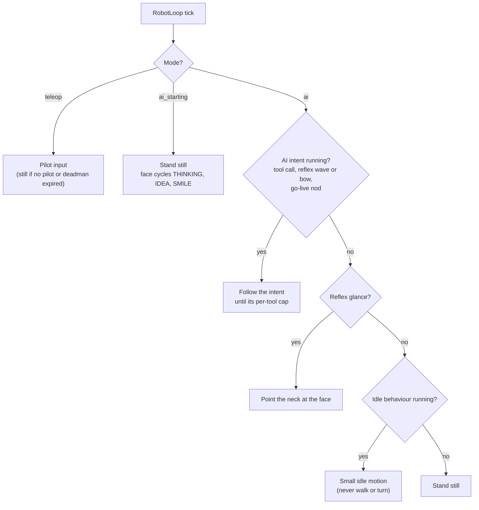

# Palmimo Controller system diagram

How the parts of Palmimo Controller connect, from the browser to the servos.
The [README](../README.md) explains each part; this page shows them together.

## Components

`PilotSession` is the one place that holds "what the robot should do now".
Everything on the server's asyncio loop writes to it; only the `RobotLoop`
thread reads it and talks to `Palmimo`.

```mermaid
flowchart LR
    subgraph Browser["Browser (phone or laptop, same LAN)"]
        Pilot["/pilot page<br/>d-pad, neck, gestures, AI mode button"]
        Viewer["/ viewer page<br/>video, status, prompt/voice/audio settings"]
    end

    subgraph Server["server.py (FastAPI, asyncio event loop)"]
        WS["/api/control WebSocket<br/>pilot frames in, 2 Hz status out"]
        REST["/api/prompts, /api/voice,<br/>/api/audio, /api/modes"]
        MJPEG["/video.mjpeg"]
    end

    subgraph AI["AiController: one TaskGroup per AI session"]
        Mic["MicrophoneFeed<br/>mic to 24 kHz PCM"]
        Realtime["RealtimeClient<br/>OpenAI Realtime websocket"]
        Router["_route: audio to Playback,<br/>tool calls to run_tool"]
        Tools["ai/tools.py run_tool<br/>walk, turn, gesture, look,<br/>set_face, stop"]
        Reflexes["ai/reflexes.py Reflexes<br/>wave back, bow, glance"]
        Idle["ai/idle.py Idle<br/>look around, tilt, stretch, face"]
    end

    Session[("session.py PilotSession<br/>single writer, mode state,<br/>effective_input(), face_cue()")]
    Loop["robot_loop.py RobotLoop<br/>own thread, 60 Hz tick"]
    Video["video.py VideoStream<br/>latest head-camera frame"]
    Vision["ai/vision.py<br/>WaveDetector, FaceLocator<br/>(MediaPipe)"]
    Robot["palmimo_sdk Palmimo<br/>servos, face display, head camera"]
    OpenAI(["OpenAI Realtime API"])
    Speaker(["Speaker (aplay)"])

    Pilot <--> WS
    Viewer <--> REST
    Viewer --> MJPEG
    Pilot --> MJPEG
    WS -->|pilot input, play, switch mode| Session
    WS -->|start / stop AI| AI
    REST -->|prompt, voice, levels| AI

    Mic --> Realtime
    Realtime <--> OpenAI
    Realtime --> Router
    Router --> Speaker
    Router --> Tools
    Tools -->|set_ai_intent, set_ai_face| Session
    Video --> Reflexes
    Reflexes --> Vision
    Reflexes -->|set_ai_intent, set_gaze| Session
    Idle -->|set_idle, set_idle_face| Session

    Session -->|effective_input, face_cue| Loop
    Loop -->|set_motion, look, step,<br/>display.set_expression| Robot
    Robot -->|frames| Video
    Video --> MJPEG
```

## What drives the robot in AI mode

`PilotSession.effective_input()` resolves one input per control tick. In an AI
mode the pilot's own input is ignored, and the first layer that is active wins:

Any write to a higher layer drops the layers below it at once: an AI intent
ends a glance and any idle behaviour, and a glance ends idle. Ending the AI
session resets all of them, and the robot settles back to teleop.
